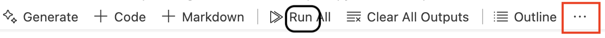
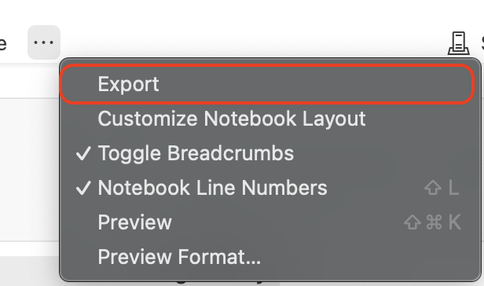
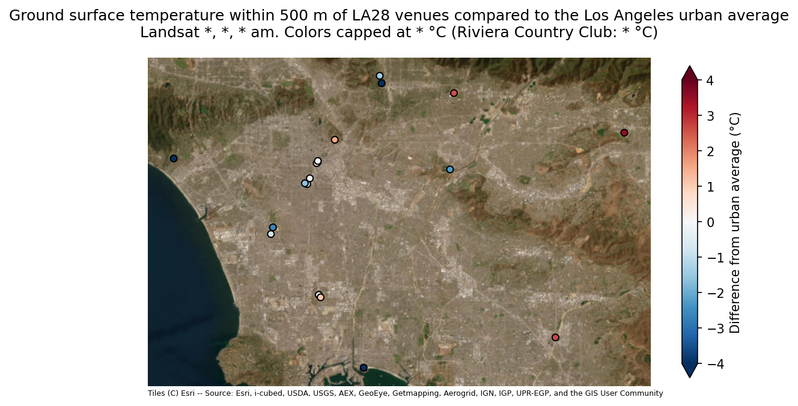

# Final project

The project consists of two tasks:

- Task 1: add a blog post to your personal website based on one of your previous assignments and discussion sections. This task is 35% of the final project grade.
- Task 2: create a presentation-ready GitHub repository featuring geospatial analysis in Python. This task is 65% of the final project grade.


## Submission instructions
:::{.callout-warning appearance="minimal"} 
Due dates:

- Task 1 (blog post) is due by 11:59 pm on .

- Task 2 (GitHub repo) is due by 11:59 pm on .

Feedback for both tasks will be given to students by  and the final resubmission for both tasks is due by  on  (last day of the quarter). **Both a submission and a revised submission addressing all the feedback from the first submission will be needed to get a final grade for these two tasks.** *An assignment without a resubmission will get a 0 grade.*

All tasks for this assignment should be submitted via Gradescope. 

File formatting and uploading:

- [ ] Your blog post (task 1) must be submitted as a PDF file.
- [ ] Your notebook with solutions for task 2 must be submitted as a PDF file.
- [ ] Additionally, for task 2, link your whole GitHub repository on the indicated Gradescope assignment.

If you have any questions about assignment logistics, please reach out to  or  by 5 pm on the day before the due dates.
:::


:::{.callout-warning appearance="minimal" collapse="true" }
### Converting your notebook to PDF
To convert your notebook to PDF, we will first convert your notebook to HTML, and then save as PDF.  

1. Open your notebook in VS Code.

2. Select the three dots at the top of your notebook. 




3. Select Export > HTML (**not PDF**)


{width=70%}


4. Choose where you want to save this HTML to your computer

5. Open up the HTML and go to File > Print > Save as PDF

6. Save your PDF and submit to Gradescope. 


:::

## Task 1: Eaton and Palisades Fires analysis blog post

In this task, you will transform your presentation-ready repository from Homework 4 into a polished blog post for your personal website and compile and streamline all its supporting notebooks.

### Purpose

Your blog post should showcase **two out of the three** data analysis exercises we did related to the Eaton and Palisades Fires:

- False color image analysis ([Hwk 4 - Task 2](/assignments/assignment4-palisades-eaton-fires.qmd))
- Social dimensions analysis with the EJI dataset ([ week 8 discussion section exercises](/discussion-sections/ds8-eji-eaton-palisades.qmd))
- Land cover statistics ([exercises from the land cover statistics lesson](/book/chapters/lesson-17-raster-wrangling/lesson-17-raster-wrangling.qmd))

<!--
:::{.callout-warning appearance="minimal"} 
If you decide to include the land cover statistics (greatly encouraged!), you should start your analysis from the terrestrial ecosystems data clipped over the Thomas Fire perimeter. You can find this ready-to-use raster and the terrestrial ecosystem labels at this directory within workbench-1:
```default
/courses/EDS220/data/USGS_National_Terrestrial_Ecosystems_Over_Thomas_Fire_Perimeter/
```
:::
-->

Your audience is a fellow Python programmer with beginner-to-intermediate geospatial wrangling experience. This is an opportunity to highlight your skills and communicate your analysis in a clear and engaging way! 

To help you understand the desired format and text-to-code ratio, review these examples:

- [https://haylee360.github.io/posts/2024-12-01-thomas-fire/thomas-fire-analysis.html](https://haylee360.github.io/posts/2024-12-01-thomas-fire/thomas-fire-analysis.html)

<!-- - [https://aoverbye.github.io/blog_posts/2024-12-2-thomas-fire-post/thomas_fire_blog_edit.html](https://aoverbye.github.io/blog_posts/2024-12-2-thomas-fire-post/thomas_fire_blog_edit.html) -->

- [https://learning.nceas.ucsb.edu/2023-03-arctic/sections/geopandas.html](https://learning.nceas.ucsb.edu/2023-03-arctic/sections/geopandas.html).

Take note of how they balance explanations, code, and visualizations to communicate their analyses effectively.

In addition to the blog post, the notebooks used for the data analysis should be part of your presentation-ready GitHub repository. These notebooks contain work you have already completed and probably revised, so the effort should go into cleaning and streamlining them. 

### Setup

:::{.callout-tip appearance="minimal" collapse="true"}
## Setting up your website

A Quarto personal website will be needed to submit the blog post. If you previously attended the [MEDS Career & Professional Development Workshop Series]() then you're all set! If you don't have a website, this tutorial will smoothly guide you through creating one:

- [Creating personal websites using Quarto](https://ucsb-meds.github.io/creating-quarto-websites/)

Customizing your website is optional. This is a tutorial to help you add customizations:

- [Customizing Quarto Websites using CSS & Sass](https://ucsb-meds.github.io/customizing-quarto-websites/)
:::

:::{.callout-tip appearance="minimal" collapse="true"}
## Adding a blog post to your website

To create a blog post listing in your personal website you can follow this tutorial:

- [Adding a blog to your existing Quarto website](https://samanthacsik.github.io/posts/2022-10-24-quarto-blogs/)

The tutorial assumes you will be writing your blog post as a Quarto (`.qmd`) file. You can: 

1. Directly add your Jupyter notebook (`.ipynb` file) to the appropriate website folder and Quarto should render it directly. These instructions will guide you on how to do it:

- [How to add a Jupyter notebook (.ipynb) to your Quarto website as a blog post]()

or

2. If you want all your blog posts to be `.qmd` files, converting a Jupyter notebook into a Quarto file and vice versa can be done using the [`quarto convert`](https://quarto.org/docs/tools/jupyter-lab.html#converting-notebooks) command. 

:::

:::{.callout-tip appearance="minimal" collapse="true"}
## GitHub repository structure

In addition to the blog post, in this task you will expand the GitHub repository you created for homework 4 by including the notebook with the other fire data analysis into it. Follow the repository structure below:

```default
repo-name  # Consider renaming, e.g., "eaton-palisades-fires-analysis"
│   README.md
|   notebooks  # As needed per analysis, clean and streamlined
|   .gitignore
│
└── data  # If needed
    │   data-files  
```
**Important notes:**

- Make sure no `.DS_Store` or `.ipynb_checkpoints` files are present in your repository.

- All notebooks should be streamlined and will be checked using the "notebooks organization" rubric!
:::

:::{.callout-warning appearance="minimal"}
📋 Don't forget to read the [rubric for task 1]() before you start working on it. 

💡 For your first blog post submission, it’s normal to receive feedback and a “needs revision” rating. Implementing the requested changes during resubmission can earn you 100% of the points. However, if no revised blog post is submitted, this task will count as 0%. Revising will be a crucial part of this task! 
:::

### Guidelines

:::{.callout-tip appearance="minimal"}
This task builds on your previous work. Your **first step should be to carefully review the feedback you received on your notebooks and Homework 4 repository and make all the necessary updates**.

💡 If you have questions or need clarification on the feedback, don't hesitate to ask!
:::

Your post should be streamlined, focusing on key steps and results. Avoid lengthy print checks and intermediate outputs, favoring concise, well-explained code chunks.

Your post should include (at least) the following:

- **About section:** 
  - Provide context for the analysis. Introduce the Eaton and Palisades Fires, their significance, and the relevance of your analyses.
  - Include an image related to the analysis.
- **Highlights of analysis:**
  - List of highlights of analysis (3 or 4 highlights). What do you consider to be the most important techniques used or insights from the analysis?
- **Dataset descriptions:**
  - Describe the datasets you used and provide proper citations or references.

- **Link to GitHub repository:**
  - Include a link to your GitHub repository at the top of the post. The repository should be presentation-ready and contain the full, detailed analysis.

- **Organized data analysis sections:** 
  - Break the analysis into logical sections.
  - Include only the most relevant code.
  - Aim for a clean, professional layout with properly formatted code snippets and images.

- **Final visualizations:**
  -  Showcase your main visualizations with clear captions. Follow each visualization with a description explaining takeaways and relevance.

## Task 2: Urban heat around LA28 Olympic facilities

Los Angeles will host the 2028 Summer Olympic and Paralympic Games (LA28) in July and August, during peak summer heat. Many events will take place in existing stadiums, arenas and parks spread across the Los Angeles area, and heat is a major concern for athletes, workers and spectators. LA28 has pledged to include shade planning and heat mitigation in its preparations for the Games, and regional efforts such as ShadeLA aim to add shade around Olympic venues and in the city's most heat-vulnerable neighborhoods [@ucla_shadela_2025].

In this task, you will do an analysis using Landsat surface temperature data: on a clear summer day, which LA28 facilities sit in areas hotter or cooler than the Los Angeles urban area as a whole, and by how much? You will answer this question in **relative** terms: how many degrees above or below the urban area's average each facility is, *on the same date*.

{width="85%"}

### About the data

You will work with three datasets for this task:

1. **Landsat Collection 2 Level-2 surface temperature**
Access the `landsat-c2-l2` collection from the [Microsoft Planetary Computer STAC catalog](https://planetarycomputer.microsoft.com/dataset/landsat-c2-l2) @usgs_landsat_c2_l2_mpc. You will use the surface temperature asset (`lwir11`). Pixels are 30 m, resampled from the thermal sensor's native 100 m resolution.

2. **Los Angeles urban area**
The [urban area polygons from the Census Bureau's 2026 TIGER/Line shapefiles](https://www.census.gov/geographies/mapping-files/time-series/geo/tiger-line-file.2026.html#form-dropdown-790442341) @us_census_bureau_tiger_2026_uac. The Census defines urban areas as densely developed territory, so the average temperature over this polygon represents the city people live in, without the mountains, desert or ocean that a county or city boundary would include. This is the reference area you will compare each facility to. The name for the LA area is *Los Angeles--Long Beach--Anaheim, CA*. 

3. **LA28 facilities**
A CSV file with the 19 permanent, on-land LA28 competition facilities in the Los Angeles area, with their approximate coordinates. The list comes from the official LA28 venue list @la28_venues_2026, cross-referenced with the venue statuses on Wikipedia @wikipedia_la28_venues_2026. It includes stadiums and arenas (e.g. SoFi Stadium, Crypto.com Arena, the Rose Bowl, Dodger Stadium) and other permanent sites such as Riviera Country Club, Santa Anita Park and the Fairplex. It leaves out:

    - temporary venues (e.g. Venice Beach, Sepulveda Basin), since Landsat can only see what is built today;
    - water venues (e.g. the Port of Los Angeles, Long Beach Marine Stadium), since over water Landsat measures the water surface;
    - venues outside the Los Angeles area (e.g. Trestles, Oklahoma City, and the football stadiums in other cities).

    All 19 facilities are inside the Los Angeles urban area. You can find the CSV file `la28-facilities.csv` in the [course data directory]().

:::{.callout-note appearance="minimal"}
**Surface temperature is not air temperature.** Landsat measures the thermal radiation coming off the top millimeter of whatever it sees from above: roofs, pavement, treetops, grass, water. Dark pavement and roofs in full sun often reach 50 to 70 °C, while the air a few feet above them is much cooler. Air temperature (what a weather station reports) is measured in the shade, about 2 m above the ground, and changes much more slowly across a city. Keep in mind that surface temperature is a good indicator of where the built environment stores heat (and where shade or vegetation would help), but it is not a direct measure of how hot people feel. 

<!-- Absolute surface temperatures also change a lot from one day to the next. This is why we compare each facility to the urban average on the same date. -->
:::

### Setup

:::{.callout-tip appearance="minimal"}
1. Read all the instructions and the r[ubric for this task]().

2. Create a new GitHub repository to house task 2 work. Choose an adequate, informative title for your repository (not `EDS220-final-project`). Your repository should have the a structure similar to this one:

```default
repo-name
│   README.md
|   notebooks
|   .gitignore
│
└── data  # If needed
    │   data-files
```

In particular, there should be no `.DS_Store` or `.ipynb_checkpoints` files in your repository.
:::

:::{.callout-warning appearance="minimal"}
📋 Don't forget to read the [rubric for this task]() before you start working on it!
:::

### Instructions

#### 1. Data analysis

1. **Explore the vector data.** Explore the data and write a summary of the information you obtained from the preliminary exploration. 

2. **STAC search.** Use the Los Angeles urban area to search the Microsoft Planetary Computer STAC catalog for Landsat Collection 2 Level-2 scenes from June 1 to September 30, 2026. Your search should look similar to this:

```python
search = catalog.search(
    collections=___,
    bbox=___,
    datetime=___,
    query={'eo:cloud_cover': {'lt': 10}},
)
items = search.item_collection()
```
The `query` parameter of `catalog.search()` filters items by any property in their metadata. Here we use `eo:cloud_cover` (a percentage) to keep only scenes with less than 10% cloud cover. Clouds hide the ground from the thermal sensor, so we only want nearly cloud-free scenes.


3. **Pick a scene.** Landsat scenes are tiles, and the Los Angeles urban area sits near the corner of one, so not every scene covers all the facilities. Adapt the following code so you can run it, and explain in a markdown cell what it does and what its output shows:

```python
from shapely.geometry import shape   # Move import to an adequate place

facilities_4326 = facilities.to_crs('epsg:4326')

for item in items:
    footprint = shape(item.geometry)
    print(item.id,
          item.properties['eo:cloud_cover'],
          'covers all facilities:', facilities_4326.within(footprint).all())
```

Then pick a scene to use for your analysis and, in a markdown cell, justify your choice. 

4. **Access the raster.** Retrieve the item byou selected and open its surface temperature asset (`lwir11`) as an `xarray.DataArray`. Plot the raster together with the facilities and the urban area polygon.

::: {.callout-note collapse="true"}
## HINT: mask no data values
- The surface temperature file uses 0 to mark pixels with no data. Open the raster with `rioxr.open_rasterio(..., masked=True)` so these pixels become `NaN` when the file is loaded and don't sneak into your calculations.
:::

5. **Convert to degrees Celsius.** The values in the surface temperature raster are not temperatures. To save space, Landsat stores each temperature as an integer that needs to be converted back with

$$\text{temperature (K)} = \text{value} \times \text{scale} + \text{offset}.$$

The file itself doesn't record the scale and offset (if you check the raster's attributes you will see rioxarray's defaults, a scale of 1 and an offset of 0). The real scale and offset are in the STAC metadata for the asset:

```python
item.assets['lwir11'].extra_fields['raster:bands']
```

Clip the raster to the Los Angeles urban area and convert its values to degrees Celsius. Review your results.

6. **Facilities vs. the urban area.** Calculate each facility's average surface temperature within 500 m of it, and its difference from the average surface temperature over the whole urban area. Before you start coding, take a moment to write step-by-step instructions for yourself about how to get this result. You don't need to include these in your notebook, but you should have a plan before starting your code.

::: {.callout-note collapse="true"}
## HINT: use `buffer()` and make one calculation

- The `buffer()` method of a `geopandas.GeoDataFrame` turns each point into a circle of a given radius, measured in the units of the geo-data frame's CRS.
- Do it for one facility first, then iterate. 
:::

7. **Difference plot.** Make a bar plot showing each facility's difference from the urban average. You can adapt this code to your results (`results` is a data frame with columns `facility` and `diff_from_urban_c`):

```python
plot_data = results.set_index('facility').sort_values('diff_from_urban_c')
colors = ['tab:red' if d > 0 else 'tab:blue' for d in plot_data['diff_from_urban_c']]

ax = plot_data['diff_from_urban_c'].plot.barh(figsize=(7, 7), color=colors)
ax.axvline(0, color='black', linewidth=0.8)
ax.set_xlabel(f'Mean surface temperature within 500 m minus urban average ({urban_mean:.1f} °C)')
ax.set_ylabel('')
ax.set_title('Surface temperature around LA28 facilities\nDATE, TIME')
plt.show()
```

8. **Final map.** Create a map of the facilities colored by their difference from the urban average, over a base map. Use the `contextily` package for the base map. Here's an example:

::: {.column-body-outset}
{width="100%" fig-alt="Satellite basemap of the Los Angeles area with the LA28 facilities as small circles colored from blue (cooler than the urban average) to red (hotter than the urban average)."}
:::

9. **Discussion.** In markdown cells, answer the following questions (short answers):

    1. Which scene (date) did you use? Which facilities have the minimum and maximum difference from the urban average, and what are these values?
    2. Explain two limitations of the data.
    3. Explain two limitations of the methods.
    4. Discuss your results in relation to the facilities' locations and the type of facility (and any other characteristics you think matter).
    5. LA28 is planning heat mitigation for the Games. Based on your map, which venue would you prioritize for heat mitigation and why? What would you need to know beyond this analysis to make that recommendation?

#### 2. Clean notebook

The target audience for your notebook is a fellow EDS 220 student who is just learning geospatial wrangling using Python.

- Add enough and appropriate comments to explain your code.
- First cell in the notebook must be a markdown cell including:
  - [ ] Title
  - [ ] Author
  - [ ] Link to GitHub repository containing the notebook (for grading purposes)
- At the top of the notebook, include an "About" section with the following subsections:
    - [ ] Purpose: what is this notebook about?
    - [ ] Highlights: List of highlights of analysis (3 or 4 highlights). What do you consider to be the most important aspects of this coding exercise?
    - [ ] About the data: Datasets description
    - [ ] References: Formal references to datasets. You can use the APA style as outlined [here](https://library.cumc.columbia.edu/insight/citing-data-sources).
- The rest of your notebook should have:
    - [ ] Logical subsections (indicated through markdown headers) for the data exploration, analysis, and visualization you are performing. The subsections should easily guide the reader through the analysis.
    - [ ] Enough and appropriate **markdown cells to explain the procedures you are using and their output**. Copy-pasting the instructions in markdown cells is not appropriate. If your code comment is getting too long, you should probably move it to a markdown cell as text.

#### 3. Clean repository

Same as the instructions for Homework 4. Update your repository's README with (at least) the following (based on [EDS 296](https://ucsb-meds.github.io/README-guidelines/)):

- [ ] **Title.** Short, but descriptive title.
- [ ] **"About" section.** A brief explanation of the repository’s purpose.
  Paragraphs or a bulleted list are both acceptable options.
  You may include an image or logo that represents the project.
- [ ] **"Repository Structure" section.** A concise description of what’s housed in the repository.
  This includes information about the repository structure or file organization.
- [ ] **"Data" section.** Details regarding data access. Any necessary information on where data lives (e.g. is it housed in the repo, on a server, in a library / package etc.) and how to access it in order to run the code.
- [ ] **"References" section.** In an appropriate, consistent format, including links, provide a reference to the course and any other sources that supported the development of the repository. **Include formal references to the datasets.** You can use the APA style to cite data sources as outlined [here](https://library.cumc.columbia.edu/insight/citing-data-sources).

:::{.callout-warning appearance="minimal"}
Ready to submit your answers? Make sure your submission follows the checklist at the top of the assignment!
:::
