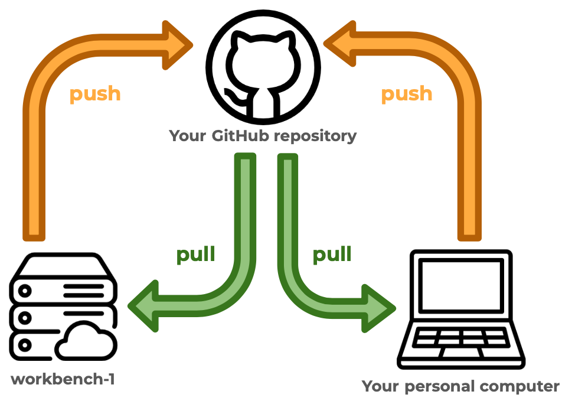
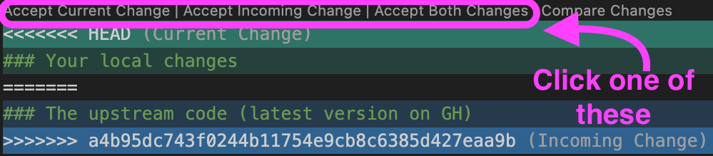
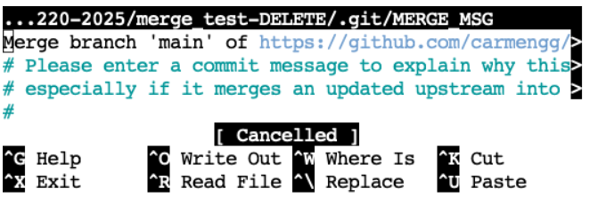

# Merge conflicts

Git tracks changes by noting which lines of code have changed - you can only add, delete, or change (delete then add) a line at a time. When collaborating with others (or with yourself on different computers) on coding tasks, occasionally the same line may be changed simultaneously. This results in a merge conflict!


In this activity we will:

1) Create and resolve a merge conflict individually on a Quarto file. 

2) Complete a git merge commit on a Quarto file.

3) Create and resolve merge conflicts on a Quarto file with a partner. 

 blog [GitHub for supporting, contributing, and failing safely](https://www.openscapes.org/blog/2022/05/27/github-illustrated-series/) by Allison Horst and Julia Lowndes.](images/git-merge-conflicts/horst-git.png)

## Setup (everyone, individual)

### Step 1: Create a GitHub repository

1. Log in to GitHub.

2. Create a new repository on GitHub. Use the following settings:

    - Repository name: `merge_test_YOURLASTNAME`.

    - Description: Repo to practice resolving git merge conflicts (delete later).

    - Visibility: Keep the repository public.

    - Don't select any template to start.

    - Add a README file.

    - Add a Python .gitignore template.

    - No license.

### Step 2 (@ personal computer): Clone your repository and check your git configuration

1. Using VSCode, clone your repository.

2. Verify your merge configuration by running this command in the terminal:

```bash
git config --global --list
```

This command shows you all the settings git is using at the moment. Your output should look something like this:

```text
user.name=carmengg
user.email=c_galazgarcia@ucsb.edu
credential.helper=cache --timeout=10000000
[...]
pull.rebase=false
```

If you see `pull.rebase=false` it means you have the right configuration. Otherwise, update the default method for pulling into repositories on your personal computer by running this line of code in the terminal:
```bash
git config --global pull.rebase false
```

### Step 3 (@ personal computer): Check Quarto and VSCode extensions

1. Verify that Quarto is installed by running this command in the terminal:

```bash
quarto --version
```

The output should be a version number. If you get an error like `command not found`, [install Quarto](https://quarto.org/docs/get-started/) before continuing.

2. In VSCode, go to the extensions panel and verify you have the Python, Jupyter, and Quarto extensions installed. If any of them is missing, install it (see [Set up VSCode](/setup/setup-vscode.qmd)) and restart VSCode.

## Activity 1: merge conflict

In this activity you will create a merge conflict with yourself. The setup is a common workflow: working on the same documents on two different computers. In our case, we will use the workbench as one computer, and your personal computer as the second one. 

{fig-alt="Diagram of the activity setup: workbench-1 and your personal computer each push to and pull from your GitHub repository."}

### Step 1 (@ personal computer): Write some code

1. Create a new Quarto document called `merge_test_YOURLASTNAME.qmd`.

2. Copy the following code into a Python code chunk in your Quarto file:

```python
import pandas as pd
import numpy as np

# Create a random number generator with a seed
rng = np.random.default_rng(seed=42)

# Create a test 10x3 dataframe
df = pd.DataFrame({
    "A": np.arange(1, 11),
    "B": rng.integers(10, 100, size=10),
    "C": rng.choice(["w", "x", "y", "z"], size=10)
})

print(df)

# Select rows subset
subset = df[df['C'] == 'w']

print("Subset has", len(subset), "rows.")
```

3. Examine the code, make sure you understand what it is doing! 

4. In a *bash terminal*, activate the course environment:
```bash
conda activate eds220-env
```


5. Preview the output of the Quarto file by running 
```bash
quarto preview merge_test_YOURLASTNAME.qmd
```

6. Save your Quarto file, pull, commit, and push your updates to GitHub. 

7. Go over to GitHub and look at your repository. Your Quarto file is now upstream!

### Step 2 (@ workbench): Clone repo and update code

1. Clone the `merge_test_YOURLASTNAME` repository to your workbench-1 workspace. 

2. Check that `pull.rebase` is configured on the workbench by running this in the terminal:
```bash
git config --global pull.rebase
```
If the output is `false`, you are all set. If there is no output, run 
```bash
git config --global pull.rebase false
```

3. Open the Quarto file and update the `Select rows subset` to *select a different letter*. Remember which letter you chose!

4. Save and try to pull. What does it tell you and why?

5. Commit, pull, and push your changes. Do your changes go through? Why or why not?

6. Go over to GitHub and look at your repository. Your updated Quarto file is now upstream!

### Step 3 (@ personal computer): Update code without pulling changes

**Let's go back to the repo `merge_test_YOURLASTNAME` on your personal computer.**

1. **Do not pull.** Not pulling when you re-engage with your work is a bad practice! But we need to do it in order to create the merge conflict. 😈

2. Update the selection again, this time to a letter different from both the original one and the one you chose on the workbench. If both computers make the exact same change, git merges them without a conflict! You may preview the output if you want. 

3. Save and commit your work, then try to pull again. What does it tell you? Read the message carefully!

4. Congrats, you’ve created a merge conflict! 

### Step 4 (@ personal computer): Resolve merge conflict

1. Don’t panic!

2. Look at the Quarto document and identify where the conflict has occurred. It will look something like this:

```text
<<<<<<< HEAD
### Your local changes
=======
### The upstream code (latest version on GH)
>>>>>>> a4b95dc743f0244b11754e9cb8c6385d427eaa9b
```

3. Decide what to do with the code inside the `<<<<<<<` and `>>>>>>>`. Four options:

    a. Keep your new code.
    b. Keep your upstream code.
    c. Combine the best parts of code from each.
    d. Delete it all and write something completely different.

4. Resolve the conflict. On VSCode you can use the IDE buttons at the top of the conflict:

{fig-alt="A merge conflict in VSCode. Above the conflict markers are the buttons Accept Current Change, Accept Incoming Change, Accept Both Changes and Compare Changes."}

Or you can also manually edit the file by deleting the boundary lines around the merge conflict (the lines containing `<<<<<<<`, `=======`, and `>>>>>>>`).

5. Once you are done resolving the conflict, save your work, commit (explaining how you resolved it), pull, and push.

**NOTE: sometimes, multiple conflicts may have occurred in different places in the same file, or in separate files.** You must resolve them all before you can wrap up the merge conflict.

6. Celebrate! 🎉

::: {.callout-note}
## Stuck in the middle of a merge?

If you get lost while resolving a merge conflict, you can cancel the merge by running `git merge --abort` in the terminal. This takes your files back to how they were before you pulled, so you can start over.
:::

::: {.callout-tip}
## Always do `git pull` before starting to update your code!

If you are your only collaborator, the safest way to avoid creating merge conflicts with yourself is to always run `git pull` when you start working locally. 
:::

## Activity 2: merge without issues

We don't necessarily get a merge conflict every time that a file is modified separately more than once. Sometimes git is able to reconcile the two versions. Conflicts often happen when the same line of code is being updated. Here we'll see an example of a merge without a conflict.

### Setup

1. Do `git pull` on your personal computer.

2. Do `git pull` on workbench-1.

Now we are sure we have the latest version of the file on both computers. 

### Step 1 (@ personal computer): Update code

1. Update some of the code that is creating the data frame. Perhaps update the letters or numbers that are selected or the column names, or the shape of the data frame. *Do not update any other code.*

2. Commit, pull, and push your changes.


### Step 2 (@ workbench): Update code (a different section)

1. **Do not pull.** We already know better, but let's pretend we were distracted today and we forgot! 

2. Update the code that subsets the data frame by selecting a different letter. Notice we are not updating the same code as before. 

3. Save and commit your work, then try to pull again. What does it tell you? Read the message carefully!

### Step 3 (@ workbench): Commit the merge

There were no merge conflicts because git managed to merge your code with the upstream code. However, git still needs to create a **merge commit message**. So, it opens a text editor where you can update the draft merge commit message. 

1. Make any updates to the git merge message. This is optional, you can just keep the default message. 

2. If the text editor looks like this, you are in `Vim`:

```text
Merge branch 'main' of https://github.com/carmengg/merge_test-DELETE
# Please enter a commit message to explain why this merge is necessary,
# especially if it merges an updated upstream into a topic branch.
#
# Lines starting with '#' will be ignored, and an empty message aborts
# the commit.
~                                                                                                   
~                                                                                                   
~                                                                                                   
~          
```

Update the message if needed. To exit the editor:

a. Press `Esc`
b. Type `:wq` (which means write and quit)
c. Press `Enter`

3. If the text editor looks like this, you are in `nano`:

{width=60% fig-alt="The nano text editor showing the default merge commit message, with the keyboard shortcuts listed at the bottom."}

Update the message if needed. To exit the editor:

a. Press `CTRL + O` (the letter O, not zero) to save.
b. Press `Enter` to confirm the file name.
c. Exit the editor by pressing `CTRL + X`.

4. Push your changes. And pull in your local computer.

5. Congrats! You merged without conflicts! 🎊

::: {.callout-warning}
## A merge without conflicts does not mean your code works

Git combines changes line by line. It does not check whether the merged code runs or does what you want. After any merge, re-run your code to check that it still works.
:::


::: {.callout-tip}
## Remember: Always do `git pull` before starting to update your code!

Even if merge commits are not a big deal, the best practice is to keep your git history clean by running `git pull` when you start working. 
:::


## Activity 3: create and resolve merge conflict in pairs

For this activity, pair up with a partner and assign roles for team member 1 and 2. We will test if you're able to create and resolve a git merge conflict!

1. **Team member 1:** Add team member 2 as a collaborator to your `merge_test_YOURLASTNAME` repository. On GitHub, go to your repository's **Settings**, then **Collaborators**, click **Add people** and search for team member 2's GitHub username.

2. **Team member 2:** Accept the invitation from the email GitHub sends you. You won't be able to push to team member 1's repository until you accept it.


3. **Team member 2:** Clone team member 1's repository to your local computer using VSCode. You already configured `pull.rebase` on your computer during the setup, so there is no need to do it again.

4. As a team, work to create a merge conflict that team member 1 can resolve. Decide:

- Who needs to update what file?
- When should each of you push or pull?

5. Now try creating another merge conflict so that team member 2 can resolve it.

6. Discuss: what are some best practices you can follow with a team to avoid having merge conflicts?


## Clean your workspace

We won't be using any of these repositories later on. So:

- delete all files from your local computer and the workbench associated with this activity, 
- delete the `merge_test_YOURLASTNAME` repository on GitHub.

## What about notebooks?

In this activity we used a Quarto file, but most of your work in this course is in Jupyter notebooks. Merge conflicts in notebooks are much harder to resolve, so the best strategy is to avoid them.

### What a notebook looks like under the hood

A `.ipynb` file is not a plain list of code lines like a `.qmd` or `.py` file. It is a text file in JSON format that stores every cell together with information about it. For example, this is how one code cell is saved:

```json
{
 "cell_type": "code",
 "execution_count": 3,
 "id": "a1b2c3d4",
 "metadata": {},
 "outputs": [
  {
   "name": "stdout",
   "output_type": "stream",
   "text": [
    "Subset has 3 rows.\n"
   ]
  }
 ],
 "source": [
  "subset = df[df['C'] == 'w']\n",
  "print(\"Subset has\", len(subset), \"rows.\")"
 ]
}
```

Your code is only the `source` part. Everything else can change even if you don't touch a single line of code:

- **Execution counts**: the `execution_count` number changes every time you run a cell, and it depends on the order in which you run them.
- **Outputs**: re-running a cell saves its new output. Anything that changes between runs (random numbers, warnings, file paths, the time) changes the file.
- **Plots**: figures are saved inside the notebook as very long blocks of encoded text. Re-running a plotting cell can rewrite the whole block.
- **Notebook metadata**: the notebook also stores which kernel and Python version were used. Opening and running it with a different kernel, for example on the workbench and then on your personal computer, can update this information.

So, if you run the same notebook on two computers, git sees changes in both places even if you only edited the code on one of them. 

### Conflicts in a notebook

When a conflict does happen, git adds the `<<<<<<<`, `=======` and `>>>>>>>` markers inside the JSON. The file is then no longer a valid notebook, so VSCode may not be able to open it as one.

To see what this looks like, you can [download and open a notebook that was broken by a git merge](https://github.com/carmengg/merge_test_GG/blob/main/merge_text.ipynb).

There's software that can help you compare notebooks and resolve conflicts in them, for example [nbdime](https://nbdime.readthedocs.io/), a tool for diffing and merging Jupyter notebooks. In the course, we will focus on best practices to prevent a conflict.
 
### Prevention rules

- 🔄 **Pull before you start working and push when you stop.** This is the same rule as before, and it matters even more with notebooks.
- 💻 **Work on a notebook in one place at a time.** Don't have the same notebook open and running on two computers. If you switch computers, commit and push on the first one, then pull on the second one before opening the notebook.
- 🧹 **Clear outputs before committing while you work.** In VSCode, use the *Clear All Outputs* button, then save and commit. This removes most of the changes that are not about your code. 

The exception is your final submission: homework notebooks must be submitted with all their outputs, so run all cells before your last commit.

- 👥 **In a team, use one notebook per person.** If several people need to work on the same analysis, split it into separate notebooks instead of editing the same one.

- 📄 **For shared work, use plain-text files such as Quarto documents (`.qmd`) or Python scripts (`.py`).** Notebooks are great for exploring data and presenting your results, but they are not the best format for code that several people edit at the same time.

## Wrap up

Merge conflicts are not errors. They are git asking you to decide what the code should look like when the same lines were changed in two places. 

The most important habit to take away: **always `git pull` before you start working, and commit and push when you stop.** Most merge conflicts, in Quarto files and notebooks alike, can be avoided this way!