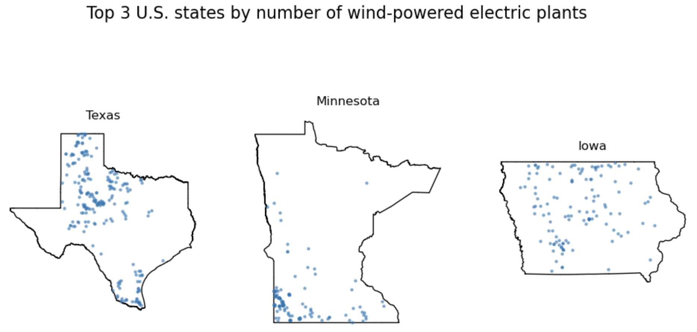
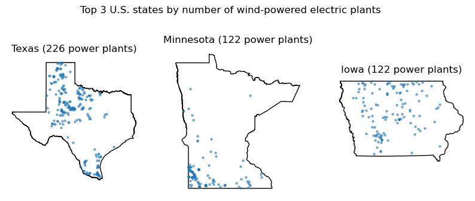

# 13 Functions

In this lesson we will learn how to write our own functions to reuse code. We will go over the syntax of a function, how to check its inputs, and a step-by-step strategy to turn code that works for one example into a function that works for any input.

By the end of this lesson, students will be able to:

- write functions with parameters, return values and docstrings
- use `assert` to check a function's inputs
- explain why a function should not depend on global variables
- turn code that solves a concrete example into a reusable function

## What are functions?

In Python, **functions** are reusable blocks of code designed to perform specific tasks. They help streamline your code by allowing you to avoid repetition, improve readability, and make maintenance easier.

The general syntax for defining a function is the following:

```python
def function_name(parameter_1, ..., parameter_n):
    """Docstring"""
    <body of the function>
    return value  # Depending on the function
```

We define a function using:

 1. the `def` keyword, followed by the function name, parentheses (which can contain parameters), and a colon.
 2. The first line(s) of the function should be a `docstring`. This is a string, written between triple quotes `"""`, that describes what the function does. It must be indented. Unlike a comment, Python stores the docstring with the function, so you can read it with `help(function_name)`.
 3. After the docstring, you write the body of the function. This is the code that will be executed when the function is called. The whole body of the function should be indented to indicate the function's scope.
 4. The `return` keyword is used to allow the function to return values. Functions that do not return any values don't need to have a `return` keyword.

Let's see two simple examples just to get familiar with the syntax. In the first one we have a simple function with a one-line docstring, no parameters, and no return values.

```{python}
def greet():
    """Print a greeting message."""
    print("Hello, welcome to the class!")

greet()
```

The second one has a single parameter and a more detailed docstring with information about the arguments and return values.

```{python}
def calculate_area(radius):
    """
    Calculate the area of a circle given its radius.

    Args:
        radius (float): The radius of the circle.

    Returns:
        float: The area of the circle, calculated as π * radius^2.
    """
    area = 3.14159 * radius ** 2
    return area

# Using our function
for radius in [1, 2, 3, 4, 5]:
    area = calculate_area(radius)
    print(f"The area of a circle with radius {radius} is {area:.2f}")
```

We can read the docstring of our function using `help()`:

```{python}
help(calculate_area)
```

## Adding checks with `assert`

Sometimes we want a function to stop and give a helpful message when it gets an input that doesn't make sense. We can do this with an `assert` statement, like we did to check our data in the [previous lesson](lesson-11-csv-to-geo.qmd):

```python
assert <condition that should be True>, "Message explaining what went wrong"
```

Let's update `calculate_area` so it gives an error when the radius is negative:

```{python}
#| error: true
def calculate_area(radius):
    """
    Calculate the area of a circle given its radius.

    Args:
        radius (float): The radius of the circle.

    Returns:
        float: The area of the circle, calculated as π * radius^2.
    """
    # Check that radius is not negative
    assert radius >= 0, f"radius must be non-negative, got {radius}"

    area = 3.14159 * radius ** 2
    return area

# Check if the assertion works
calculate_area(-2)
```

In production code, input checks like this one are usually written with `raise` instead of `assert`, but `assert` works well at this stage. You can learn more about `raise` [here](https://realpython.com/python-raise-exception/). The core idea is that you can build in checks to test the inputs and outputs of your functions.

## Global variables

A **global variable** is a variable defined outside of any function, for example directly in a notebook cell. Functions can use global variables even if we don't pass them as parameters. Let's see why this can be a problem:

```{python}
threshold = 30   # °C

def is_hot(temp):
    """Check if a temperature is above the threshold."""
    return temp > threshold

print(is_hot(32))   # True

# Later in the notebook, for another analysis...
threshold = 50

print(is_hot(32))   # False: same input, different answer!
```

`is_hot` uses the global variable `threshold`, so its result changed even though we passed the same temperature. We can fix this by making `threshold` a parameter:

```{python}
def is_hot(temp, threshold):
    """Check if a temperature is above a threshold."""
    return temp > threshold

print(is_hot(32, 30))   # True
print(is_hot(32, 50))   # False
```

Now the result depends only on what we pass to the function.

**The best practice is for every variable used inside a function to be either a parameter or defined inside the function.**

We'll come back to this when we write our own functions.

## Data loading and preparation

We'll practice creating functions using the power plants and US states datasets from the [previous lesson](lesson-11-csv-to-geo.qmd).

```{python}
import os

import pandas as pd
import geopandas as gpd
import matplotlib.pyplot as plt

# Display all columns when looking at dataframes
pd.set_option("display.max_columns", None)

# --------------------------------------------------
# Import power plants data
URL = 'https://raw.githubusercontent.com/carmengg/eds-220-book/refs/heads/main/data/power_plants_epsg4269.csv'
power_plants = pd.read_csv(URL)

# Import states data
fp = os.path.join('data','tl_2026_us_state','tl_2026_us_state.shp')
states = gpd.read_file(fp)
states.columns = states.columns.str.lower()

# --------------------------------------------------
# Create geometry column for power plants
points = gpd.points_from_xy(power_plants['longitude'],
                            power_plants['latitude'])

# Convert power plants DataFrame to GeoDataFrame
power_plants = gpd.GeoDataFrame(power_plants,      # Data
                                geometry=points,   # Specify geometry column
                                crs='EPSG:4269'    # Specify CRS
                                )
```

## Previous work: CA top power plant sources map

In the previous lesson we solved the following exercise using a `for` loop with `zip()` to create subplots of California's top 3 primary sources by number of power plants.

```{python}
# --- Find top sources by number of plants
ca_power_plants = power_plants[power_plants['state']=='California']
ca_top_sources = (ca_power_plants['primsource']
                            .value_counts()
                            .index[:3]
                            .tolist()
                            )

# --- Plot
# Select CA state boundary
ca_boundary = states[states['name'] == 'California']

# Create subplots for each top source in a single figure
fig, ax = plt.subplots(figsize=(12,6), nrows=1, ncols=3)
for axis, source in zip(ax, ca_top_sources):   # Iterate over subplots and energy sources

    axis.set_title(source)
    axis.axis('off')

    ca_boundary.plot(ax=axis,
                     color='none')

    # Subset power plants by source and plot
    source_subset = ca_power_plants[ca_power_plants['primsource'] == source]
    source_subset.plot(ax=axis,
                    markersize=5,
                    alpha=0.5)

fig.suptitle("Top 3 primary sources by number of power plants in California")
plt.show()
```

## Steps to create a function

Our previous code "hard-codes" California, so it only works for that state. Next, we want to keep exploring the top 3 primary sources by number of power plants for different states. This is a scenario where creating functions can be useful.

Let's make a function that finds the top 3 primary sources by number of power plants for any state! My general advice to break down this problem is:

- Step 1: solve the problem for a concrete example
- Step 2: identify which parts of the code need to be generalized and update them
- Step 3: wrap the code inside a function
- Step 4: turn global variables inside the function into parameters
- Step 5: add a docstring and tests as needed

### Step 1: solve the problem for a concrete example

My recommendation is to first write code that solves the problem just for a specific example (e.g., California). Don't even think about the function yet.

In our case we need to:

1. Subset power plants for the given state

2. Count how many times each power source appears in that subset

3. Sort counts and select the top 3; this should be a list

You can do this part mentally, but it can be useful to actually write down what steps you need to take.

Let's implement steps 1-3.

```{python}
ca_power_plants = power_plants[power_plants['state']=='California']
ca_top_sources = (ca_power_plants['primsource']
                            .value_counts()
                            .index[:3]
                            .tolist()
                            )
ca_top_sources
```

Great, now that we have code that works for a specific example, let's turn it into a function!

### Step 2: identify which parts of the code need to be generalized

In our case, we need to have the function work for any state, not just California. So we need to generalize the state name to be its own variable. We do this by replacing `'California'` with a variable called `state` and re-run things to make sure it still works.

```{python}
state = 'California'

state_power_plants = power_plants[power_plants['state']==state]
state_top_sources = (state_power_plants['primsource']
                            .value_counts()
                            .index[:3]
                            .tolist()
                            )
state_top_sources
```

### Step 3: wrap the code inside a function

Now we can wrap the code into a function. The variable becomes a parameter for the function. Make sure everything is properly indented.

```{python}
def top3_sources(state):
    state_power_plants = power_plants[power_plants['state']==state]
    state_top_sources = (state_power_plants['primsource']
                   .value_counts()
                   .index[:3]
                   .tolist()
                   )

    return state_top_sources
```

We may now reuse this function as much as we want!

```{python}
print('Top 3 primary sources by number of power plants in Division 2 states:')
for state in ['New Jersey', 'New York', 'Pennsylvania']:
    print(f"{state}: {', '.join(top3_sources(state))}")
```

### Step 4: turn global variables used inside the function into parameters

Here we ask: is every variable used inside the function either a parameter or defined inside the function?

The only variable used in the function that is not defined in the function's body or passed as a parameter is `power_plants`. We turn it into a parameter called `plants`:

```{python}
def top3_sources(state, plants):

    state_plants = plants[plants['state']==state]
    top_sources = (state_plants['primsource']
            .value_counts()
            .index[:3]
            .tolist()
            )

    return top_sources
```

Notice that we named the data frame parameter `plants` instead of `power_plants`. Inside the function, `plants` is whatever data frame we pass when we call it. Giving parameters different names from the variables in our notebook makes sure the function uses only what we pass to it, and doesn't depend on a variable that happens to exist outside of it.

### Step 5: add a docstring and tests as needed

Finally, we can add a docstring to explain what the function does, its parameters, and its return values. We also use `assert` to check that the state is in the data.

```{python}
def top3_sources(state, plants):
    """
    Find the top 3 primary sources by number of power plants in a given state.

    Args:
        state (str): The US state we want information about.
        plants (pd.DataFrame): DataFrame containing data
        on power plants, with at least 'state' and 'primsource' columns.

    Returns:
        list: The 3 primary sources with the most power plants in the state, from most to fewest plants.
    """

    # Check that state is in the plants data
    # Note: `in` on a Series checks the index, so we use .values to check the values
    assert state in plants['state'].values, f"{state} is not in the 'state' column of plants"

    state_plants = plants[plants['state']==state]
    state_top_plants = (state_plants['primsource']
            .value_counts()
            .index[:3]
            .tolist()
            )

    return state_top_plants
```

```{python}
print('Top 3 primary sources by number of power plants in Division 2 states:')
for state in ['New Jersey', 'New York', 'Pennsylvania']:
    print(f"{state}: {', '.join(top3_sources(state, power_plants))}")
```

Let's check that our error works with a misspelled state name:

```{python}
#| error: true
top3_sources('Californa', power_plants)
```

:::{.callout-tip}
## Exercise 1

Create a function called `power_source_counts` that, given a power source, returns a Series with the counts of power plants by state that use that source.

Follow the steps:

- Step 1: solve the problem for a concrete example
- Step 2: identify which parts of the code need to be generalized and update them
- Step 3: wrap the code inside a function
- Step 4: turn global variables inside the function into parameters
- Step 5: add a docstring and tests as needed

<!--
```python
# 1. Solve for a specific example
wind_plants = power_plants[power_plants['primsource'] == 'wind']
wind_plants['state'].value_counts()

# Steps 2-5
def power_source_counts(source, plants):
    """
    Given a power source, returns a Series with the counts of power plants by state that use that source.

    Args:
        source (str): The primary source of energy to filter power plants by.
        plants (gpd.GeoDataFrame): GeoDataFrame containing data
        on power plants, with at least 'state' and 'primsource' columns.

    Returns:
        pd.Series: A Series with the counts of power plants by state that use the given source.
    """
    source_plants = plants[plants['primsource'] == source]
    return source_plants['state'].value_counts()

power_source_counts('wind', power_plants)
```
-->
:::

## Plotting the top 3 sources for any state

Let's do one more example and create a function that will produce a plot of the top 3 primary sources by number of power plants for a given state.

### Step 1: solve the problem for a concrete example

We can start with the code we had for California. We will use our `top3_sources` function instead of the code that found the `ca_top_sources` list.

```{python}
# CA top 3 primary sources by number of power plants
ca_top_sources = top3_sources('California', power_plants)

# Select CA power plants and boundary
ca_power_plants = power_plants[power_plants['state'] == 'California']
ca_boundary = states[states['name'] == "California"]

# Create subplots for each top source in a single figure
fig, ax = plt.subplots(figsize=(12,6), nrows=1, ncols=3)
for axis, source in zip(ax, ca_top_sources):   # Iterate over subplots and energy sources

    axis.set_title(source)
    axis.axis('off')

    ca_boundary.plot(ax=axis,
                     color='none')

    # Subset power plants by source and plot
    source_subset = ca_power_plants[ca_power_plants['primsource'] == source]
    source_subset.plot(ax=axis,
                    markersize=5,
                    alpha=0.5)

fig.suptitle("Top 3 primary sources by number of power plants in California")
plt.tight_layout()
plt.show()
```

### Step 2: identify which parts of the code need to be generalized and update them

Basically anything where we are using California specifically.

1. First update all the `'California'` strings to use a variable called `state` instead.

2. Then, update all variables that have `ca_` to be more general (e.g., `state_power_plants`, `state_boundary`).

```{python}
state = 'California'

# Find top 3 primary sources by number of power plants
state_top_sources = top3_sources(state, power_plants)

# Select power plants and boundary
state_power_plants = power_plants[power_plants['state'] == state]
state_boundary = states[states['name'] == state]

# Create subplots for each top source in a single figure
fig, ax = plt.subplots(figsize=(12,6), nrows=1, ncols=3)
for axis, source in zip(ax, state_top_sources):   # Iterate over subplots and energy sources

    axis.set_title(source)
    axis.axis('off')

    state_boundary.plot(ax=axis,
                     color='none')

    # Subset power plants by source and plot
    source_subset = state_power_plants[state_power_plants['primsource'] == source]
    source_subset.plot(ax=axis,
                    markersize=5,
                    alpha=0.5)

fig.suptitle(f"Top 3 primary sources by number of power plants in {state}")
plt.tight_layout()
plt.show()
```

### Step 3: wrap the code inside a function

```{python}
def plot_top3_power_sources(state):

    # Find top 3 primary sources by number of power plants
    state_top_sources = top3_sources(state, power_plants)

    # Select power plants and boundary
    state_power_plants = power_plants[power_plants['state'] == state]
    state_boundary = states[states['name'] == state]

    # Create subplots for each top source in a single figure
    fig, ax = plt.subplots(figsize=(12,6), nrows=1, ncols=3)
    for axis, source in zip(ax, state_top_sources):   # Iterate over subplots and energy sources

        axis.set_title(source)
        axis.axis('off')

        state_boundary.plot(ax=axis,
                        color='none')

        # Subset power plants by source and plot
        source_subset = state_power_plants[state_power_plants['primsource'] == source]
        source_subset.plot(ax=axis,
                        markersize=5,
                        alpha=0.5)

    fig.suptitle(f"Top 3 primary sources by number of power plants in {state}")
    plt.tight_layout()
    plt.show()
```

```{python}
plot_top3_power_sources('Oregon')
```

### Step 4: turn global variables inside the function into parameters

To find these, ask yourself: what variables are being used inside the function that were neither (1) passed as parameters nor (2) defined inside the function?

Here, `power_plants` and `states` are global variables, so we turn them into the parameters `plants` and `boundaries`.

```{python}
def plot_top3_power_sources(state, plants, boundaries):

    # Find top 3 primary sources by number of power plants
    state_top_sources = top3_sources(state, plants)

    # Select power plants and boundary
    state_power_plants = plants[plants['state'] == state]
    state_boundary = boundaries[boundaries['name'] == state]

    # Create subplots for each top source in a single figure
    fig, ax = plt.subplots(figsize=(12,6), nrows=1, ncols=3)
    for axis, source in zip(ax, state_top_sources):   # Iterate over subplots and energy sources

        axis.set_title(source)
        axis.axis('off')

        state_boundary.plot(ax=axis,
                        color='none')

        # Subset power plants by source and plot
        source_subset = state_power_plants[state_power_plants['primsource'] == source]
        source_subset.plot(ax=axis,
                        markersize=5,
                        alpha=0.5)

    fig.suptitle(f"Top 3 primary sources by number of power plants in {state}")
    plt.tight_layout()
    plt.show()
```

```{python}
plot_top3_power_sources('Oregon', power_plants, states)
```

### Step 5: add a docstring and tests as needed

We add a docstring and use `assert` to check that the state is in `boundaries`. We don't need to check `plants`, since `top3_sources` already does that for us.

```{python}
def plot_top3_power_sources(state, plants, boundaries):
    """
    Plot the power plants of a given state for its top 3 primary sources
    by number of power plants.

    Args:
        state (str): The US state we want to plot.
        plants (gpd.GeoDataFrame): GeoDataFrame containing data
        on power plants, with at least 'state' and 'primsource' columns.
        boundaries (gpd.GeoDataFrame): GeoDataFrame with the US states boundaries,
        with at least a 'name' column.
    """
    # Check that state is in boundaries
    # (top3_sources already checks that state is in plants)
    assert state in boundaries['name'].values, f"{state} is not in the 'name' column of boundaries"

    # Find top 3 primary sources by number of power plants
    state_top_sources = top3_sources(state, plants)

    # Select power plants and boundary
    state_power_plants = plants[plants['state'] == state]
    state_boundary = boundaries[boundaries['name'] == state]

    # Create subplots for each top source in a single figure
    fig, ax = plt.subplots(figsize=(12,6), nrows=1, ncols=3)
    for axis, source in zip(ax, state_top_sources):   # Iterate over subplots and energy sources

        axis.set_title(source)
        axis.axis('off')

        state_boundary.plot(ax=axis,
                        color='none')

        # Subset power plants by source and plot
        source_subset = state_power_plants[state_power_plants['primsource'] == source]
        source_subset.plot(ax=axis,
                        markersize=5,
                        alpha=0.5)

    fig.suptitle(f"Top 3 primary sources by number of power plants in {state}")
    plt.tight_layout()
    plt.show()
```

We can now use our function to produce plots for any state:

```{python}
plot_top3_power_sources('New Jersey', power_plants, states)
```

Writing functions can feel challenging at first, but with practice, they'll start to come naturally whenever you find yourself reusing blocks of code. Keep experimenting and practicing—it gets easier with each function you write!

## Exercises

:::{.callout-tip}
## Exercise 2

1. Recreate the following plot.
2. Make a function that produces this plot for any power source.
3. Brainstorm ways in which your function might break or not produce the desired output.



<!--
```python
def plot_top3_states_by_source(source, plants, boundaries):
    """
    Plot the power plants with a given primary energy source in the
    3 states that have the most of them.

    Args:
        source (str): The primary energy source (e.g., 'wind').
        plants (gpd.GeoDataFrame): GeoDataFrame containing data on power plants,
        with at least 'state' and 'primsource' columns.
        boundaries (gpd.GeoDataFrame): GeoDataFrame with the US states boundaries,
        with at least a 'name' column.
    """
    # Top 3 states by number of power plants with this source
    top_states = power_source_counts(source, plants).head(3)

    fig, ax = plt.subplots(figsize=(12,6), nrows=1, ncols=3)

    for axis, state in zip(ax, top_states.index):

        axis.set_title(f"{state}")
        axis.axis('off')

        state_boundary = boundaries[boundaries['name'] == state]
        state_boundary.plot(ax=axis,
                            color='none')

        state_power_plants = plants[plants['state'] == state]

        source_subset = state_power_plants[state_power_plants['primsource'] == source]
        source_subset.plot(ax=axis,
                        markersize=5,
                        alpha=0.5)

    plt.suptitle(f"Top 3 U.S. states by number of {source}-powered electric plants",
                fontsize=16)
    plt.show()

plot_top3_states_by_source('wind', power_plants, states)
```

3. Possible ways the function might break or not produce the desired output:

- Typo or different capitalization in the source (e.g., 'Wind'): no error, just three empty panels. We could check with assert source in plants['primsource'].values.
- Source used in fewer than 3 states: some panels stay empty. This doesn't happen with our data, but it could with other data.
- Ties: if the 3rd and 4th states have the same count, .head(3) keeps only one of them. For wind, Minnesota and Iowa are tied with 122 plants each.
- State names don't match between plants and boundaries (e.g., 'CA' vs 'California'): the plants are plotted without the state outline.
- Different CRS for plants and boundaries: the points don't line up with the outline. We could check with assert plants.crs == boundaries.crs.
- Missing columns ('state', 'primsource' or 'name'): we get a KeyError.
- The number 3 is hard-coded: the function always makes three panels.
-->
:::

:::{.callout-tip}
## Bonus

Create a function that, for a given power source, produces a plot like this one. Many ways of doing it, a hint could be to zip three things together: the axes, the top 3 states, and the counts of power plants in those states.

```python
# Example of more than two zipped items

for a, b, c in zip([1,2,3], ['x','y','z'], [10,20,30]):
    print(a, b, c)
```



<!--
```python
def plot_top3_states_counts(source, plants, boundaries):
    """
    Plot the power plants with a given primary energy source in the
    3 states that have the most of them, with the counts in the titles.

    Args:
        source (str): The primary energy source (e.g., 'wind').
        plants (gpd.GeoDataFrame): GeoDataFrame containing data on power plants,
        with at least 'state' and 'primsource' columns.
        boundaries (gpd.GeoDataFrame): GeoDataFrame with the US states boundaries,
        with at least a 'name' column.
    """
    top3 = power_source_counts(source, plants).head(3)
    source_plants = plants[plants['primsource'] == source]

    fig, axes = plt.subplots(nrows=1, ncols=3, figsize=(10, 4))

    for ax, state, count in zip(axes, top3.index, top3.values):
        boundaries[boundaries['name'] == state].plot(ax=ax,
                                                     color='none',
                                                     edgecolor='black')
        source_plants[source_plants['state'] == state].plot(ax=ax,
                                                            markersize=5,
                                                            alpha=0.5)
        ax.set_title(f"{state} ({count} power plants)")
        ax.axis('off')

    fig.suptitle(f"Top 3 U.S. states by number of {source}-powered electric plants")
    plt.show()

plot_top3_states_counts('wind', power_plants, states)
```
-->
:::
