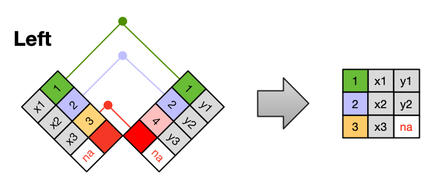
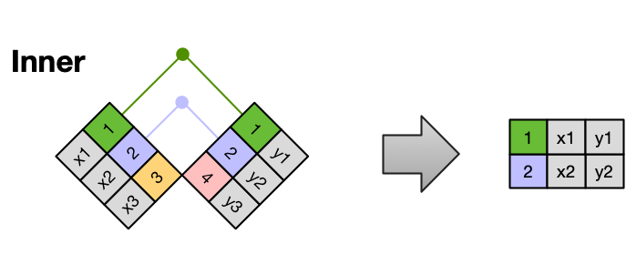

# 13 Reprojecting and merging

In this lesson we will learn how to join data frames and will apply this to creating a [choropleth map](https://en.wikipedia.org/wiki/Choropleth_map) with `geopandas`.

## About the data

The first dataset we will use is a [list of Arctic communities and their location](https://search.dataone.org/view/doi%3A10.18739%2FA28S4JQ80) @brook_approximate_2023 created by the [Alaska Native Tribal Health Consortium](https://www.anthc.org). This data comes in a GeoJSON file with the following attributes:

- **name**: name of Arctic community
- **population**: population of Arctic community, as of 2022
- **country**: country that the Arctic community falls within (see dataset metadata for the codes)
- **geoname-id**: numeric codes that uniquely identify all administrative/legal and statistical geographic areas for which the Census Bureau tabulates data

The second dataset is [Natural Earth's medium-scale cultural boundaries data for countries (1:50m)](https://www.naturalearthdata.com/downloads/50m-cultural-vectors/). 
We can obtain this dataset by downloading the shapefile. 
[Natural Earth](https://www.naturalearthdata.com) is a public domain dataset with free, ready-to-use data for creating maps. 

The third dataset we will use is a CSV file with the country codes and names of the Arctic countries in the Arctic communities dataset. This dataset was created for educational purposes for this lesson based on the metadata of the Arctic communities dataset and the country names in Natural Earth's dataset. It can be accessed [here](https://github.com/MEDS-eds-220/MEDS-eds-220-course/blob/main/book/chapters/lesson-12-merge-data/country_names.csv).

## Import data

We will first import the countries shapefile and adapt it for wrangling purposes:

```{python}
import os
import pandas as pd
import matplotlib.pyplot as plt
import geopandas as gpd

# Import countries polygons
fp = os.path.join('data', 'ne_50m_admin_0_countries', 'ne_50m_admin_0_countries.shp')
countries = gpd.read_file(fp)

# Simplify column names
countries.columns = countries.columns.str.lower()

# Select columns for analysis
countries = countries[['admin', 'type', 'geometry']]

countries.head()
```

```{python}
# Quick view
countries.plot()
```


Next, we import the Arctic communities data. Similar to how we previously used `pandas.read_csv()`, we can read in the Arctic communities GeoJSON data directly from the data repository using `geopandas.read_file()`:

```{python}
# Import Arctic communities data
URL = 'https://cn.dataone.org/cn/v2/resolve/urn%3Auuid%3Aed7718ae-fb0d-43dd-9270-fbfe80bfc7a4'
communities = gpd.read_file(URL)

communities.head()
```

Both datasets use the EPSG:4326 CRS. Remember all GeoJSON files are given in this CRS and all points are expressed in longitude and latitude units of decimal degrees.

```{python}
print(countries.crs)
```

Since the CRSs of our geospatial data match, it is easy to take a quick look at our communities data by plotting it on top of the countries data frame:

```{python}
# Verify CRSs match
assert countries.crs == communities.crs

fig, ax = plt.subplots()
countries.plot(ax=ax)
communities.plot(ax=ax, color='red')
plt.show()
```

Finally, we import the country names and codes CSV:

```{python}
# Import country names from URL
URL = 'https://raw.githubusercontent.com/MEDS-eds-220/MEDS-eds-220-course/refs/heads/main/book/chapters/lesson-12-merge-data/country_names.csv'
country_names = pd.read_csv(URL)
country_names.head()
```

## Arctic communities by country

Next, we want to calculate the number of Arctic communities by country. 

```{python}
# Create data frame with number of communities per country
n_comms = (communities.groupby('country')
                      .size()
                      .reset_index(name='n_communities'))
```

Let's break this down:

- We start with our `communities` data frame and use `groupby('country')` to group by country code.
- Then we use [`size()`](https://pandas.pydata.org/docs/reference/api/pandas.api.typing.DataFrameGroupBy.size.html) as an aggregator function to calculate the size of each group.
- The result of this operation is a `pandas.Series` indexed by the `country` values.
- By resetting the index we transform the `pandas.Series` into a `pandas.DataFrame`; the index is now a column named `country` and the values of the series are named `n_communities`.

```{python}
# Number of Arctic communities per country
n_comms
```

## `if`-`else` statements

Our goal is to merge the `n_comms` and the `countries` data frames. To merge two data frames they need to have at least one column in common. 
Currently our datasets do not have any columns in common:

```{python}
set(countries.columns).intersection(n_comms.columns)
```

The output `set()` represents the empty set. This might not be as informative, so let's write a different notification:

```{python}
common_columns = set(countries.columns).intersection(n_comms.columns)

# Check if there are any common columns
if len(common_columns) != 0:
    print(f"Common columns: {common_columns}")
else:
    print("No common columns")
```

Remember that an `if-else` statement is a control structure that allows code to make decisions: it checks a condition, and if that condition is true, it executes one block of code (the `if` block); if the condition is false, it executes a different block (the `else` block). This enables programs to respond differently depending on specific criteria or inputs.

:::{.callout-tip}
## Check-in
Wrap up the previous code into a function called `check_common_columns` that prints a message depending on whether two data frames have common columns or not. Don't forget to include a docstring!
<!--

```{python}
def check_common_columns(df1, df2):
    """
    Prints a message depending on whether df1 and df2 have columns in common

    Parameters:
    - df1: The first DataFrame.
    - df2: The second DataFrame.
    
    Returns:
    - A set of common column names. If no columns are common, returns an empty set.
    """

    common_columns = set(df1.columns).intersection(df2.columns)
    
    if common_columns:
        print(f"Common columns: {common_columns}")
    else:
        print("No common columns")
    
    return common_columns
```
-->
:::

## Merging data frames

We can use the `country_names` data frame to add the country names into the `n_comms` data which, in turn, will allow us to merge that data frame with the `countries` data. To merge data frames we can use the [`pandas.merge()` function](https://pandas.pydata.org/docs/reference/api/pandas.merge.html#pandas.merge). 
The basic syntax for it is:

```python
output_df = pd.merge(left_df,
                     right_df, 
                     how = type_of_join, 
                     on = column_to_join)
```
where

- `output_df` is the data frame resulting from the merge,
- `left_df` is the data frame we have "on the left side",
- `right_df` is the data frame we have "on the right side",
- `how` specifies the type of join between the left and right data frames, ([check the options here](https://pandas.pydata.org/docs/reference/api/pandas.merge.html#pandas.merge)), the default is to do an inner join,
- `on` specifies the column to join on; this column must be present in both our data frames. 

The `pandas.merge()` function is also available as a method of data frames: 
```python
left_df.merge(right_df, how=..., on=...)
``` 
does the same as 
```python
pd.merge(left_df, right_df, how=..., on=...)
``` 

When one of the data frames is a `geopandas.GeoDataFrame`, GeoPandas recommends calling `merge()` from the geodataframe, so the output keeps its geometry. With `pd.merge()`, the geodataframe must be the left argument, otherwise you lose the geometry and the output is a plain `pandas.DataFrame`.

So, we merge the `n_comms` and `country_names` data frames using a left join:



```{python}
n_comms = pd.merge(n_comms,
                   country_names,
                   how='left',
                   on='country')
n_comms
```

We can reuse our function to check that `n_comms` and `countries` now have a common column on which we can merge them:

```{python}
check_common_columns(n_comms, countries)
```

:::{.callout-tip}
## Check-in
Create a new variable named `arctic_countries` which is the result of an inner join between our `countries` and `n_comms` data frames. The inner join will merge the subset of rows that have matches in both the left table and the right table.


<!--
```{python}
# Merge data frames 
arctic_countries = countries.merge(n_comms,
                                   how='inner',
                                   on='admin')
```
-->
:::

## Reviewing results

It is always a good idea to check the number of rows after a merge. Our `n_comms` data frame has one row per country, but the merged data frame has one row less:

```{python}
print(f"Countries in n_comms: {len(n_comms)}")
print(f"Countries in arctic_countries: {len(arctic_countries)}")
```

An inner join only keeps the rows that have a match in both data frames, so one country in `n_comms` had no match in `countries`. We can find it using `isin()`:

```{python}
# Countries in n_comms without a match in countries
n_comms[~n_comms['admin'].isin(countries['admin'])]
```

The Aland Islands are an autonomous region of Finland and there is one Arctic community registered in this region.
Like the Faroe Islands and Greenland, the Aland Islands have their own country code in the Arctic communities data and their own polygon in Natural Earth's data.
So why didn't they match? Let's look for them in the `countries` data frame:

```{python}
countries[countries['admin'].str.contains('Aland')]
```

Natural Earth's data calls this region 'Aland', while our `country_names` data uses 'Aland Islands'. The values in the column we join on must match *exactly* for the merge to find them.
We update the name in `n_comms` to match the `countries` data and merge again:

```{python}
# Match the name used in the countries data
n_comms['admin'] = n_comms['admin'].replace('Aland Islands', 'Aland')

# Merge again
arctic_countries = countries.merge(n_comms,
                                   how='inner',
                                   on='admin')
print(f"Countries in arctic_countries: {len(arctic_countries)}")
```

## Choropleth map

A [choropleth map](https://en.wikipedia.org/wiki/Choropleth_map) is an efficient way to visualize aggregate data per region. 

Making a choropleth map from our polygons `GeoDataFrame` is easy; we just need to specify the `column` parameter in `plot()` and make it equal to the column with the values we want to plot in each country:

```{python}
arctic_countries.plot(column='n_communities',
                      legend=True)
```

## Reprojecting

Remember that CRSs reflect cultural views and even biases. Any map projection involves choices about which areas to emphasize, minimize, or distort, and those choices can influence how viewers perceive different regions. In our map, using the EPSG:4326 CRS is, among other things, mapping the Arctic regions as far apart, while they are actually near each other.

**Reprojecting** means changing the coordinate reference system of your geospatial data. In our case, we will reproject the `arctic_countries` geodataframe to the CRS EPSG:3413. 
This CRS is a *projected* CRS, better suited for working with data from the Arctic region:

](/book/images/lesson-12/epsg_3413.png)

Changing CRSs in GeoPandas is very simple using the `to_crs()` method for `geopandas.GeoDataFrame`s. 
The general syntax is:
```python
updated_geodf = geodf.to_crs(new_crs)
```
where:

- `updated_geodf` is the output of the method, a new geodataframe (`to_crs()` does not work in place), 
- `geodf` is the `geopandas.GeoDataFrame` we want to transform, 
- `new_crs` is the CRS we want to convert to; this is an object of type CRS or a string representing the CRS (ex: `'epsg:3413'`). 

In our case:

```{python}
# Reproject to CRS optimized for Arctic region
arctic_countries = arctic_countries.to_crs('epsg:3413')
```

We can now use the reprojected data to update our map:

```{python}
#| code-fold: true
fig, ax = plt.subplots(figsize=(8, 6))

# Remove the axis for a cleaner map
ax.axis('off')

# Create choropleth map of communities
# Plot with refined color and edge style
arctic_countries.plot(
    ax=ax,
    column='n_communities',
    cmap='PuBuGn',
    legend=True,
    edgecolor="0.6",
    linewidth=0.5,
    legend_kwds={
        "shrink": 0.7,
        "label": "Number of Arctic Communities",
        "orientation": "horizontal",
        "pad": 0.05
    }
)

# Add title for better context
ax.set_title('Distribution of Arctic Communities', fontsize=18, weight='bold', pad=15)

plt.show()
```

Although the new projection clearly improves the presentation of the data, there are still issues with this plot! Mainly, the entire United States territory is in it, when we should only have Alaska. **In our next lesson we will review strategies to clip and subset vector data and return to this plot in our discussion section.**
