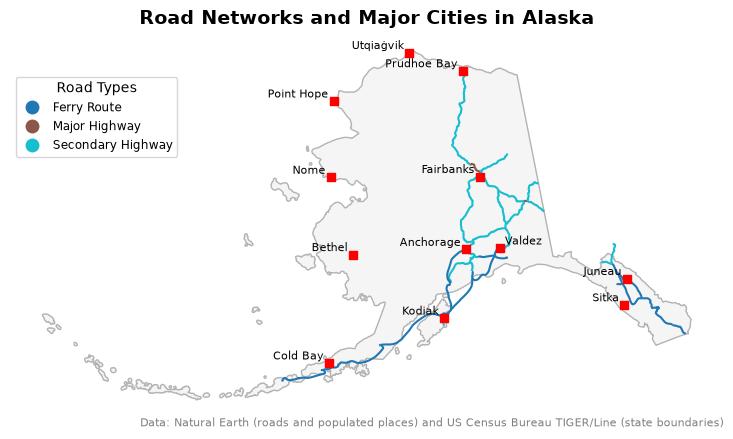
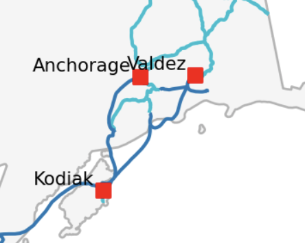

# 15 Clipping

In this lesson we will learn how to clip different geometries.

By the end of this lesson, students will be able to:

- reproject geo-dataframes so they share the same CRS before combining them
- clip a `geopandas.GeoDataFrame` to the polygons of another one using `geopandas.clip()`
- subset tabular data before applying geospatial operations
- clip a `geopandas.GeoDataFrame` to a bounding box using `total_bounds`
- decide when to clip to a bounding box instead of the exact polygons

## About the data

We will use three datasets in this lesson. 

The first dataset is a [TIGER shapefile of the US states from the United States Census Bureau](https://www.census.gov/geographies/mapping-files/time-series/geo/tiger-line-file.2026.html#form-dropdown-790442341) @us_census_bureau_tiger_2026. 
[TIGER](https://en.wikipedia.org/wiki/Topologically_Integrated_Geographic_Encoding_and_Referencing) stands for Topologically Integrated Geographic Encoding and Referencing. TIGER is the US Census Bureau's geographic database, and TIGER/Line files are extracts from it. Earlier versions of these files used a plain-text (ASCII) format; beginning with the 2007 version, they are distributed as shapefiles. You can view the metadata for all the TIGER shapefiles [here](https://www2.census.gov/geo/pdfs/maps-data/data/tiger/tgrshp2026/TGRSHP2026_TechDoc.pdf). 

Follow these steps to download the shapefile with the United States' states:

1. At the [2026 TIGER page](https://www.census.gov/geographies/mapping-files/time-series/geo/tiger-line-file.2026.html#form-dropdown-790442341), under Download, click on "Web Interface".
2. For year, select 2026, and for layer type select "States (and equivalent)". Click submit. 
3. Click on "Download national file".

The column descriptions for the US states shapefile, from the [TIGER/Line Shapefiles technical documentation](https://www2.census.gov/geo/pdfs/maps-data/data/tiger/tgrshp2026/TGRSHP2026_TechDoc.pdf), are:

| Column | Type | Description |
|--------|------|-------------|
| `REGION` | String | Region code |
| `DIVISION` | String | Division code |
| `STATEFP` | String | State FIPS code |
| `STATENS` | String | State NS code |
| `GEOID` | String | State identifier; state FIPS code |
| `GEOIDFQ` | String | Fully qualified GEOID; used to join data tables from data.census.gov |
| `STUSPS` | String | Two-character United States Postal Service (USPS) state postal abbreviation |
| `NAME` | String | State name |
| `LSAD` | String | LSAD code for the state |
| `MTFCC` | String | MAF/TIGER Feature Class Code (G4000) |
| `FUNCSTAT` | String | Functional status |
| `ALAND` | Number | Land area |
| `AWATER` | Number | Water area |
| `INTPTLAT` | String | Latitude of the internal point |
| `INTPTLON` | String | Longitude of the internal point |

The second dataset we'll use is [Natural Earth's simple medium scale populated places dataset](https://www.naturalearthdata.com/downloads/50m-cultural-vectors/) @natural_earth_populated_places_50m. We can obtain this dataset by downloading the shapefile (choose the one that says "simple (less columns)").

The third dataset we'll use is [Natural Earth's road dataset](https://www.naturalearthdata.com/downloads/10m-cultural-vectors/roads/) @natural_earth_roads_10m.
We can obtain this dataset by downloading the shapefile.

We will combine these datasets to create the following map of infrastructure in Alaska:



For these notes, all the data is inside a `data/` directory at the same level as the notebook. 

## Import data

Let's start by loading our libraries and then importing the datasets we will use.

```{python}

import os
import pandas as pd
import matplotlib.pyplot as plt
import geopandas as gpd

pd.set_option("display.max_columns", None)

# -------------------------------------
# Import states polygons
states = gpd.read_file(os.path.join('data',
                                    'tl_2026_us_state',
                                    'tl_2026_us_state.shp')
                                    )

# Import Natural Earth populated places points
places = gpd.read_file(os.path.join('data',
                                    'ne_50m_populated_places_simple',
                                    'ne_50m_populated_places_simple.shp')
                                    )

# Import roads lines
roads = gpd.read_file(os.path.join('data',
                                   'ne_10m_roads',
                                   'ne_10m_roads.shp')
                                   )
```

:::{.callout-tip}
## Check-in
Use a `for` loop to iterate over the three geo-dataframes we imported and change their column names to lowercase.

```{python}
#| include: false
for df in [states, places, roads]:
    df.columns = df.columns.str.lower()
```
:::

## Prepare Alaska multipolygon

Let's take a look at our `states` geo-dataframe. 
Since this is a geospatial dataset, exploration should include *at least* checking the head of the dataset, plotting the data, and looking at its CRS.

```{python}
print(f"CRS: {states.crs}")

states.head(3)
```

```{python}
states.plot()
```

For this lesson, we are interested in plotting data only for Alaska, so let's select this data:

```{python}
alaska = states[states['name'] == 'Alaska']
alaska.plot()
```

Notice that the way the Alaska multipolygon is plotted under the NAD83/EPSG:4269 CRS separates the islands and unnaturally elongates the map.
This happens because the westernmost Aleutian Islands cross the 180° meridian (the *antimeridian*): their longitudes jump from -180° to about +172°, so they are drawn on the opposite side of the plot.
To fix this, we will reproject the Alaska geo-dataframe to the EPSG:3338 CRS. 
This CRS is a *projected* CRS, better suited for working with data from Alaska:

](/book/images/lesson-13/epsg_3338.png)

```{python}
# Reproject to CRS optimized for Alaska
alaska = alaska.to_crs('epsg:3338')

# Inspect the new CRS
print('Is this CRS projected? ', alaska.crs.is_projected)
alaska.crs
```

```{python}
alaska.plot()
```

## Prepare populated places points

Let's now explore the populated places data. 

```{python}
print(f"CRS: {places.crs}")

places.head(3)
```

```{python}
places.plot()
```

This dataset has the EPSG:4326 CRS. Remember this is the EPSG code for the WGS 84 CRS. 
This is not a surprise since the places data is global and EPSG:4326/WGS 84 is the most widely used CRS for such data.

Let's see what happens when we try to plot this data on top of Alaska:

```{python}
# Trouble
fig, ax = plt.subplots()

alaska.plot(ax=ax)
places.plot(ax=ax, color='red')

plt.show()
```

::: {.callout-warning}
## Data in weird places? Check your CRSs
This is a classic slip in geospatial analysis. 
To plot, analyze, or integrate different geospatial datasets they **must have the same CRS**. 

Here, `alaska` and `places` have different CRSs, leading to unexpected results when plotting them together:
```{python}
alaska.crs == places.crs
```
:::

:::{.callout-tip}
## Check-in
Reproject the `places` geo-dataframe into `alaska`'s CRS and verify the CRSs match using `assert`.

```{python}
#| include: false
# Reproject to match Alaska CRS
places = places.to_crs(alaska.crs)
assert alaska.crs == places.crs
```
:::


Let's check that map again:

```{python}
fig, ax = plt.subplots()

alaska.plot(ax=ax)
places.plot(ax=ax, color='red', markersize=2)

plt.show()
```

This is better: we can see the Alaska polygons and some of the `places` points on top of it.
But why does the rest of the world look so strange?
Every CRS is designed for an area of use (look for "Area of Use" in the output of `alaska.crs` above).
EPSG:3338 is accurate around Alaska, so points far from Alaska get heavily distorted.
We don't need them anyway: next, we'll keep only the points inside Alaska.


## Clipping

**Clipping** means using a polygon (or polygons) to only select geospatial data within them. 
Clipping a `geopandas.GeoDataFrame` is simple using the geopandas [`clip()` function](https://geopandas.org/en/stable/docs/reference/api/geopandas.clip.html). 
The general syntax is:
```python
updated_geodf = geopandas.clip(geodf, mask)
```
where:

- `updated_geodf` is the output of the function: the intersection of the geometries in `geodf` with `mask`,
- `geodf` is the `geopandas.GeoDataFrame` we want to clip, 
- `mask` is a `geopandas.GeoDataFrame` with the polygon(s) we want to use for clipping (we will see later that it can also be a bounding box). This `mask` must be in the same CRS as `geodf`!

In our case:

```{python}
# Clip populated places to Alaska multipolygon
ak_places = gpd.clip(places, alaska)

fig, ax = plt.subplots()
alaska.plot(ax=ax)
ak_places.plot(ax=ax, color='red')
plt.show()
```

## Prepare roads 

Now we move on to our roads dataset. 

```{python}
print(roads.crs)

roads.head(3)
```

```{python}
roads.plot()
```

You may have already noticed that the `roads` data is not in the same CRS as the `alaska` polygons, so these geo-datasets shouldn't interact until they're in the same CRS. 
Before jumping right into reprojecting and clipping, we will subset the data to select only US roads:

```{python}
usa_roads = roads[roads['sov_a3'] == 'USA']
usa_roads.plot()
```

::: {.callout-caution}
## Reduce your tabular data before reducing via geometries
Geospatial operations are usually costly in terms of computing power. 
The more detailed our geometries are, the longer it takes to do geospatial computations. 
It's a good practice to reduce your data as much as possible before applying any geospatial transformation. 
:::


We will now compose functions to clip `usa_roads` using the `alaska` multipolygon. Notice we are using the output of `usa_roads.to_crs(alaska.crs)` directly and thus not changing the `usa_roads` geo-dataframe or creating new variables:

```{python}
# Clip usa_roads to alaska geometry
ak_roads = gpd.clip(usa_roads.to_crs(alaska.crs), alaska)


fig, ax = plt.subplots()
alaska.plot(ax=ax)
ak_roads.plot(ax=ax, color='red')
plt.show()

```

Notice the short, disconnected segments in the southwest?
Many of these "roads" are ferry routes that run over water.
Clipping to the `alaska` polygons keeps only the pieces that cross land, so clipping *exactly* to the polygons isn't what we want here.

### Clipping with a bounding box
We will clip the `usa_roads` geo-dataframe with the **bounding box** of `alaska` instead of its polygons.
A bounding box is the smallest rectangle that contains all the geometries.
It is defined by four coordinates, `minx, miny, maxx, maxy`:

{width="80%"}

Remember that the `total_bounds` attribute of a geo-dataframe gives us these four values:

```{python}
alaska.total_bounds
```

`gpd.clip()` accepts these four values directly as the `mask`, so we can clip the roads to Alaska's bounding box in one step:

```{python}
ak_complete_roads = gpd.clip(usa_roads.to_crs(alaska.crs), alaska.total_bounds)
```

The bounds are just four numbers in the units of `alaska`'s CRS (meters, for EPSG:3338).
They don't carry any CRS information, so it is up to us to make sure the data we clip is in the same CRS.
Here, we do this by reprojecting `usa_roads` to `alaska.crs` before clipping.

Notice the difference between the two clipping methods:

```{python}
fig, (ax1, ax2) = plt.subplots(2, 1, figsize=(10,10))

ak_roads.plot(ax=ax1)
ax1.set_title('Roads clipped with AK multipolygon')

ak_complete_roads.plot(ax=ax2)
ax2.set_title('Roads clipped with AK bounding box')

plt.show()
```

## Plot

Finally, we can put all our data together in the same map:

```{python}
#| code-fold: true

fig, ax = plt.subplots(figsize=(11,5))
ax.axis('off')

alaska.plot(ax=ax, color='whitesmoke', edgecolor='0.7')

ak_complete_roads.plot(ax=ax, 
                       zorder=1,  # Specify layer plotting order
                       column='type', 
                       legend=True,
                       legend_kwds={'title': "Road Types", 
                                    'loc': 'upper left',
                                    'bbox_to_anchor':(0,0.9),
                                    'fontsize':'small'}
                                    )

ak_places.plot(ax=ax, 
               zorder=2,  # Specify layer plotting order
               color='red', 
               marker='s'  # Square marker
               )
# Add city names as text annotations
for x, y, name in zip(ak_places.geometry.x, ak_places.geometry.y, ak_places['name']):
    ax.text(x-30000, y+20000, name, fontsize=8, ha='right')

ax.set_title("Road Networks and Major Cities in Alaska", fontsize=14, fontweight='bold')

# Add data sources below the map
ax.annotate("Data: Natural Earth (roads and populated places) and US Census Bureau TIGER/Line (state boundaries)",
            xy=(1, 0), xycoords='axes fraction',  # Bottom-right corner of the axes
            ha='right', va='top', fontsize=8, color='gray')

plt.show()
```

:::{.callout-tip}
## Exercise
Notice the overlapping labels for Anchorage and Valdez:

{width="40%" fig-align="center"}

Update the map so these labels do not overlap. One way to do it is using an `if` when iterating over the Alaska populated places.
Remember that the map is in the EPSG:3338 CRS, whose units are meters, so the label offsets (like `x-30000`) are in meters too.

<!--
Update text labels to this:

```python
# Add city names as text annotations
for x, y, name in zip(ak_places.geometry.x, ak_places.geometry.y, ak_places['name']):
    if name != 'Valdez':
        ax.text(x-30000, y+20000, name, fontsize=8, ha='right')

# Add text label for Valdez
valdez = ak_places[ak_places['name']=='Valdez']
ax.text(valdez.geometry.x.iloc[0]+30000, valdez.geometry.y.iloc[0]+20000, 'Valdez', fontsize=8, ha='left')
```
-->
:::

