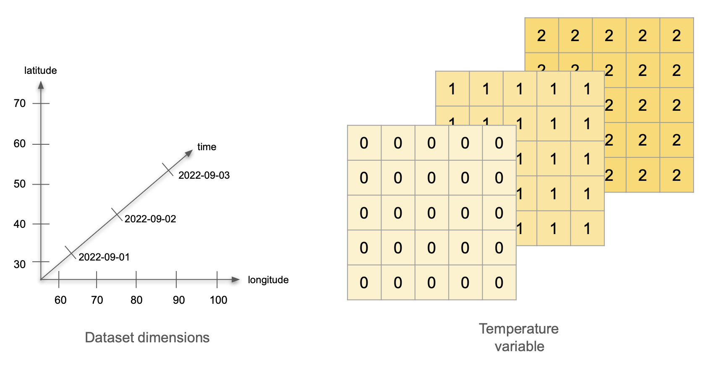
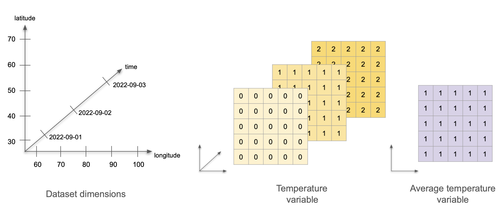
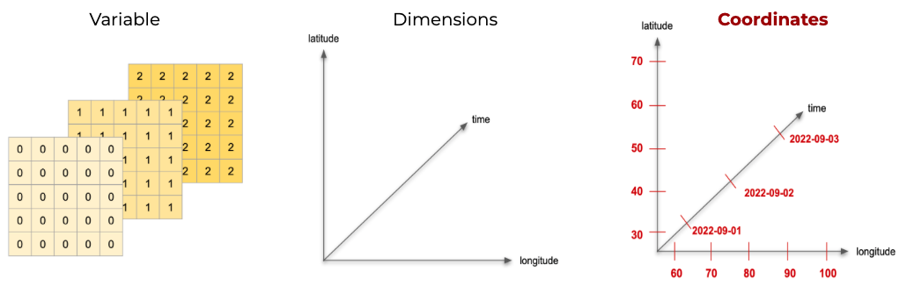
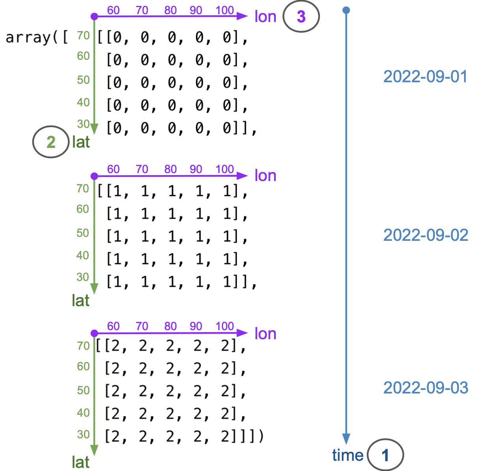

In this lesson, we will get acquainted with a popular format for working with multidimensional datasets called netCDF and the Python package `xarray` @hoyer2017xarray which is based on netCDF. 

By the end of this lesson, students will be able to:

- describe the netCDF data model in terms of variables, dimensions, and attributes
- create an `xarray.DataArray` from a NumPy array, adding dimensions, coordinates, and attributes
- subset an `xarray.DataArray` by dimension position or name, using integers or labels
- reduce an `xarray.DataArray` along a dimension
- combine several `xarray.DataArray`s into an `xarray.Dataset`
- save an `xarray.Dataset` as a netCDF file and open it again

This lesson is adapted from the netCDF and `xarray` lesson Galaz García created for the Arctic Data Center's course on scalable computing @clark_scalable_2023.

## netCDF

[Slides here.](https://docs.google.com/presentation/d/11uJ_HQd0gA2Bm04f8thUxdjzUU2TqKeouXnetw1YuU0/edit?slide=id.g297c2556425_1_83#slide=id.g297c2556425_1_83)

Efficient and reproducible data analysis begins with choosing a proper format to store our data, particularly when working with large, complex, multi-dimensional datasets. 
Consider, for example, the following Earth System Data Cube from Mahecha et al. @mahecha_earth_2020, which measures nine environmental variables at high resolution across space and time. 
We can consider this dataset large (high-resolution means we have a big file), complex (multiple variables), and multi-dimensional (each variable is measured along three dimensions: latitude, longitude, and time). 
Additionally, necessary metadata must accompany the dataset to make it functional, such as units of measurement for variables, information about the authors, and processing software used.

![Mahecha et al. 2020. *Visualization of the implemented Earth system data cube. The figure shows from the top left to bottom right the variables sensible heat (H), latent heat (LE), gross primary production (GPP), surface moisture (SM), land surface temperature (LST), air temperature (Tair), cloudiness (C), precipitation (P), and water vapour (V). The resolution in space is 0.25° and 8 d in time, and we are inspecting the time from May 2008 to May 2010; the spatial range is from 15° S to 60° N, and 10° E to 65° W.*](/book/images/lesson-14/mahecha_data_cube.png)

Keeping complex datasets in a format that facilitates access, processing, sharing, and archiving can be as important as the tools we use to analyze them. 

[netCDF](https://docs.unidata.ucar.edu/netcdf-c/current/index.html) (Network Common Data Form) is a set of popular software libraries and self-describing, machine-independent data formats for working with multi-dimensional datasets. They are designed to support the creation, access, and sharing of array-oriented scientific data.
netCDF was initially developed at the Unidata Program Center and is supported on almost all platforms, and parsers exist for most scientific programming languages. 

The [netCDF documentation](https://docs.unidata.ucar.edu/netcdf-c/current/faq.html#ncFAQGeneral) outlines that this data format is designed to be: 

>1. **Self-describing:**
Information describing the data contents of the file is embedded within the data file itself. This means that there is a header describing the layout of the rest of the file and arbitrary file metadata.
>
>2. **Scalable:**
Small subsets of large datasets may be accessed efficiently through netCDF interfaces, even from remote servers.
>
>3. **Portable:**
A netCDF file is machine-independent i.e. it can be accessed by computers with different ways of storing integers, characters, and floating-point numbers.
>
>4. **Appendable:**
Data may be appended to a properly structured netCDF file without copying the dataset or redefining its structure.
>
>5. **Sharable:**
One writer and multiple readers may simultaneously access the same netCDF file.
>
>6. **Archivable:**
Access to all earlier forms of netCDF data will be supported by current and future versions of the software.

### Data model
The netCDF data model is the way that netCDF organizes data. 
This lesson will follow the [Classic netCDF Data Model](https://docs.unidata.ucar.edu/netcdf-c/current/netcdf_data_model.html#classic_model), which is at the core of all netCDF files. 
<!--
A new Enhanced Data Model exists, but for maximum interoperability with existing code, new data should be created with the Classic Model. 
-->

The model consists of three key components: **variables**, **dimensions**, and **attributes**.

+ **Variables**
are N-dimensional arrays of data. 
We can think of these as varying/measured/dependent quantities.

+ **Dimensions**
describe the axes of the data arrays. 
A dimension has a name and a length. 
We can think of these as the constant/fixed/independent quantities at which we measure the variables.

+ **Attributes**
are small notes or supplementary metadata to annotate a variable or the file as a whole. 

)](/book/images/lesson-14/netcdf_data_model.png)

### Metadata standards

The most widely used metadata standard for climate and forecast data, especially in netCDF files, is the **Climate and Forecast metadata standard**, also called the [**CF conventions**](https://cfconventions.org). 

>The conventions for CF (Climate and Forecast) metadata are designed to promote the processing and sharing of files created with the NetCDF API.
>Principles of CF include self-describing data (no external tables needed for understanding); metadata equally readable by humans and software; minimum redundancy and maximum simplicity; and a development process focusing on existing needs. [(CF conventions FAQ)](http://cfconventions.org/faq.html)

The CF conventions provide a unique standardized name and precise description of several thousand physical variables. 
To maximize the reusability of our data, it is best to include a variable's standardized name as an attribute called `standard_name`. 
Variables should also include a `units` attribute. 
This attribute should be a string that can be recognized by UNIDATA’s [UDUNITS package](https://www.unidata.ucar.edu/software/udunits/).
In these links you can find:

* [a table with all of the CF conventions' standard names](http://cfconventions.org/Data/cf-standard-names/current/build/cf-standard-name-table.html), and

* [a list of the units found in the UDUNITS database](https://ncics.org/portfolio/other-resources/udunits2/#degree_N) maintained by the North Carolina Institute for Climate Studies. 


## `xarray`

`xarray` @hoyer2017xarray is an open source project and Python package that augments NumPy arrays by adding labeled dimensions, coordinates, and attributes. 
`xarray` is based on the netCDF data model, making it the appropriate tool to open, process, and create datasets in netCDF format. 

](/book/images/lesson-14/xarray_logo.png)


### Variables, dimensions, and attributes

**Variables, dimensions, and attributes** refer to the same components of [netCDF files we reviewed in the previous section](#netcdf).
The following is a concrete example of variables, dimensions, and attributes that will guide the rest of the section. 

#### Example: temperature at weather stations {.unlisted}

Imagine the following scenario. We have a network of 25 weather stations. 
They are located in a square grid: starting at 30°0′N 60°0′E, there is a station every 10° North and every 10° East. 
Each station measures the air temperature at a set time for three days, starting on September 1st, 2022. 
On the first day, all stations record a temperature of 0°C. 
On the second day, all temperatures are 1°C, and on the third day, all 
temperatures are 2°C. 
What are the *variables*, *dimensions* and *attributes* for this data? 

:::{.callout-tip collapse="true"}
## Answer
**Variables**: There is a single variable being measured: temperature. 
The variable values can be represented as a 3x5x5 array, with constant values for each day. 

**Dimensions**: 
This dataset has three dimensions: time, latitude, and longitude. 
Time indicates when the measurement happened; we can encode it as the dates 2022-09-01, 2022-09-02, and 2022-09-03. 
The pairs of latitude and longitude values indicate the positions of the weather stations. 
Latitude has values 30, 40, 50, 60, and 70, measured in degrees North. Longitude has values 60, 70, 80, 90, and 100, measured in degrees East. 



**Attributes**: Let’s divide these into attributes for the variable, the dimensions, and the whole dataset:

* Variable attributes:
    * Temperature attributes: 
        + standard_name: air_temperature
        + units: degree_C

* Dimension attributes:
    * Time attributes:
        + description: date of measurement

    * Latitude attributes:
        + standard_name: latitude
        + units: degree_north

    * Longitude attributes:
        + standard_name: longitude
        + units: degree_east

* Dataset attributes:
    + title: Temperature Measurements at Weather Stations
    + summary: an example of netCDF data format

:::


Now imagine we calculate the average temperature over time at each weather station, and we wish to incorporate this data into the same dataset.
How will adding the average temperature data change the dataset's variables, attributes, and dimensions?

:::{.callout-tip collapse="true"}
## Answer

**Variables**: Now we are measuring two variables: temperature and average temperature. 
The temperature data stays the same. 
We can represent the average temperature as a single 5x5 array with value 1 at each cell.

**Dimensions**: 
This dataset still has three dimensions: time, latitude, and longitude. 
The temperature variable uses all three dimensions, and the average temperature variable only uses two (latitude and longitude). 
This is ok! 
The dataset’s dimensions are the union of the dimensions of all the variables in the dataset. 
Variables in the same dataset may have all, some, or no dimensions in common.



**Attributes**:
To begin with, we need to keep all the previous attributes.
Notice that the dataset's title is general enough that we don't need to update it.
The only update we need to do is add the attributes for our new average temperature variable:

* Average temperature attributes: 
    + standard_name: mean_air_temperature
    + units: degree_C
    + description: average temperature over three days

:::

### `xarray.DataArray`

The `xarray.DataArray` is the primary data structure of the `xarray` package. 
It is an n-dimensional array with **labeled dimensions**. 
We can think of an `xarray.DataArray` as representing a single variable in the netCDF data format: it holds the variable's values, dimensions, and attributes.

Apart from variables, dimensions, and attributes, `xarray` introduces one more piece of information to keep track of a dataset's content: 
in `xarray` each dimension usually has at least one set of **coordinates**.
A dimension's coordinates indicate the dimension's values. 
We can think of the coordinate's values as the tick labels along a dimension. 

#### Example: coordinates of the weather station data {.unlisted}

In our previous exercise about temperature measured in weather stations, latitude is a dimension, and the latitude's coordinates are 30, 40, 50, 60, and 70 because those are the latitude values at which we are collecting temperature data. 
In that same exercise, time is a dimension, and its coordinates are 2022-09-01, 2022-09-02, and 2022-09-03.



Here you can read more about the [`xarray` terminology](https://docs.xarray.dev/en/stable/user-guide/terminology.html).

### Create an `xarray.DataArray`
We want to create an `xarray.DataArray` that includes the information from our previous example about measuring temperature across three days. First, we import the required libraries:

```{python}
import os              
import numpy as np
import pandas as pd
import xarray as xr   
```

#### Variable values

The underlying data in the `xarray.DataArray` is a `numpy.array` that holds the variable values. 
So we can start by making a `numpy.array` with our mock temperature data:

```{python}
# Values of a single variable at each point of the coords 
temp_data = np.array([np.zeros((5,5)), 
                      np.ones((5,5)), 
                      np.ones((5,5))*2]).astype(int)
temp_data
```

We could think this is "all" we need to represent our data.
But if we stopped at this point, we would need to 

1. remember that the numbers in this array represent the temperature in degrees Celsius (doesn't seem too bad), 

2. remember that the first dimension of the array represents time, the second latitude and the third longitude (maybe ok), and 

3. keep track of the range of values that time, latitude, and longitude take (not so good).

Keeping track of all this information separately could quickly get messy and could make it challenging to share our data and analyses with others. 
This is what the netCDF data model and `xarray` aim to simplify. 
We can get data and its descriptors together in an `xarray.DataArray` by adding the dimensions over which the variable is being measured and including attributes that appropriately describe dimensions and variables.

#### Dimensions and coordinates

To specify the dimensions of our upcoming `xarray.DataArray`, we must examine how we've constructed the `numpy.array` holding the temperature data. 
The diagram below shows how the dimensions of `temp_data` are ordered: the first dimension is time, the second is latitude, and the third is longitude. 



Remember that indexing in 2-dimensional `numpy.array`s starts at the top-left corner of the array, and it is done by rows first and columns second (like matrices). 
This is why latitude is the second dimension and longitude the third. 
From the diagram, we can also see that the coordinates (values of each dimension) are as follows:

- time coordinates are 2022-09-01, 2022-09-02, 2022-09-03
- latitude coordinates are 70, 60, 50, 40, 30 (notice decreasing order)
- longitude coordinates are 60, 70, 80, 90, 100 (notice increasing order)

We add the dimensions as a tuple of strings and coordinates as a dictionary:
```{python}
# Names of the dimensions in the required order
dims = ('time', 'lat', 'lon')

# Create coordinates to use for indexing along each dimension 
coords = {'time':pd.date_range("2022-09-01", "2022-09-03"),
          'lat':np.arange(70, 20, -10),
          'lon':np.arange(60, 110, 10)}  
```


#### Attributes

Next, we add the attributes (metadata) for our temperature data as a dictionary:

```{python}
# Attributes (metadata) of the data array 
attrs = { 'long_name':'temperature across weather stations',
          'standard_name':'air_temperature',
          'units':'degree_C'}
```


#### Putting it all together

Finally, we put all these pieces together (data, dimensions, coordinates, and attributes) to create an `xarray.DataArray`:

```{python}
# Initialize xarray.DataArray
temp = xr.DataArray(data = temp_data, 
                    dims = dims,
                    coords = coords,
                    attrs = attrs)
temp
```

We can also update the variable’s attributes after creating the object. 
Notice that each of the coordinates is also an `xarray.DataArray`, so we can add attributes to them.

```{python}
# Update attributes
temp.attrs['description'] = 'Simple example of an xarray.DataArray'

# Add attributes to coordinates 
temp.time.attrs = {'description':'date of measurement'}

temp.lat.attrs['standard_name']= 'latitude'
temp.lat.attrs['units'] = 'degree_north'

temp.lon.attrs['standard_name']= 'longitude'
temp.lon.attrs['units'] = 'degree_east'
temp
```

So far, all these attributes describe the temperature variable. When we create an `xarray.Dataset` later, we will add attributes that describe the whole dataset, like its `title`. 

### Subsetting

To select data from an `xarray.DataArray` we need to specify the subsets we want along each dimension.
We can specify the data we need from each dimension either by looking up the dimension by its position or by looking up each dimension by its name. 

| Dimension lookup | Indexing along dimension | What to use | Example |
|----------------------|--------------|-----------------|-------------|
| By position          | by integer   |  `[]`           |`temp[0,3,2]`|
| By position          | by label     |  `.loc[]`       |`temp.loc['2022-09-01', 40, 80]`|
| By name              | by integer   |  `.isel()`      |`temp.isel(time=0, lat=3, lon=2)`   |
| By name              | by label     |  `.sel()`       |`temp.sel(time='2022-09-01', lat=40, lon=80)`|

: Indexing methods summary


#### Example: temperature at one station on one day {.unlisted}

We want to know what temperature was recorded by the weather station located at 40°0′N 80°0′E on September 1st, 2022. 

**Dimension lookup by position**

When we want to rely on the position of the dimensions in the `xarray.DataArray`, we need to remember that time is the first dimension, latitude is the second, and longitude the third. 

Then, we can access the values along each dimension in two ways:

- by integer: the exact same as a `numpy.array`. Use the locator brackets `[]` and use the integer location of the data you need to retrieve it:

```{python}
# Access dimensions by position, then use integers for indexing
temp[0,3,2]
```

- by label: same as `pandas`. We use the `.loc[]` locator to look up a specific coordinate at each position (which represents a dimension):

```{python}
# Access dimensions by position, then use labels for indexing
temp.loc['2022-09-01', 40, 80]
```

For datasets with dozens of dimensions, it can be tough to remember which dimensions go where. 

**Dimension lookup by name**

We can also use the dimension names to subset data, without the need to remember which dimensions go where.
In this case, there are still two ways of selecting data along a dimension:

- by integer: we specify the integer location of the data we want along each dimension:

```{python}
# Access dimensions by name, then use integers for indexing
temp.isel(time=0, lon=2, lat=3)
```

- by label: we use the coordinate values we want to get!

```{python}
# Access dimensions by name, then use labels for indexing
temp.sel(time='2022-09-01', lat=40, lon=80)
```

Notice that the result of this indexing is a 0-dimensional `xarray.DataArray` holding a single value. 
This is because most operations on an `xarray.DataArray` return another `xarray.DataArray`. 
In particular, operations returning scalar values will also produce `xarray` objects, so we need to cast them as numbers manually using the `xarray.DataArray` [`.item()` method](https://docs.xarray.dev/en/stable/generated/xarray.DataArray.item.html):

```{python}
temp.sel(time='2022-09-01', lat=40, lon=80).item()
```

The documentation is always a great place to learn more about [`xarray` indexing](https://docs.xarray.dev/en/stable/user-guide/indexing.html).

### Reduction
`xarray` has implemented several methods to reduce an `xarray.DataArray` along any number of dimensions. 
<!--One of the advantages of `xarray.DataArray` is that, if we choose to, it can carry over attributes when doing calculations.-->
For example, we can calculate the average temperature at each weather station over time and obtain a new `xarray.DataArray`. 


```{python}
avg_temp = temp.mean(dim = 'time') 

avg_temp.attrs = {'long_name':'average temperature over three days',
                  'standard_name':'air_temperature',
                  'units':'degree_C',
                  'cell_methods':'time: mean'}
avg_temp
```

More about [`xarray` computations](https://docs.xarray.dev/en/stable/user-guide/computation.html).

## `xarray.Dataset`
An `xarray.Dataset` resembles an in-memory representation of a netCDF file and consists of *multiple* variables (each being an `xarray.DataArray`), with dimensions, coordinates, and attributes, forming a self-describing dataset. 
Attributes can be specific to each variable, each dimension, or they can describe the whole dataset. 
The variables in an `xarray.Dataset` can have the same dimensions, share some dimensions, or have no dimensions in common. 

### Create an `xarray.Dataset`
Following our previous example, we can create an `xarray.Dataset` by combining the temperature data with the average temperature data. 
We also add some attributes that now describe the whole dataset, not only each variable. 

```{python}
# Make dictionaries with variables and attributes
data_vars = {'avg_temp': avg_temp,
             'temp': temp
             }

attrs = {'title':'Temperature data at weather stations: daily and average',
         'description':'Simple example of an xarray.Dataset'
         }

# Create xarray.Dataset
temp_dataset = xr.Dataset( data_vars = data_vars,
                           attrs = attrs
                           )
```

Take some time to click through the data viewer and read through the variables and metadata in the dataset. 
Notice the following: 

+ `temp_dataset` is a dataset with three dimensions (time, latitude, and longitude), 

+ `temp` is a variable that uses all three dimensions in the dataset, and

+ `avg_temp` is a variable that only uses two dimensions (latitude and longitude).

```{python}
temp_dataset
```

### Select variables

To select a single variable from an `xarray.Dataset`, we use its name in square brackets, just like selecting a column from a `pandas.DataFrame`.
The result is an `xarray.DataArray`:

```{python}
# Select one variable: returns an xarray.DataArray
temp_dataset['avg_temp']
```

To select one or more variables and keep them in an `xarray.Dataset`, we pass a list of variable names.
The variables in the new `xarray.Dataset` follow the order of the list:

```{python}
# Select a list of variables: returns an xarray.Dataset
temp_dataset[['temp', 'avg_temp']]
```

### Save and reopen
Finally, we want to save our dataset as a netCDF file. 
To do this, specify the file path and use the *.nc* extension for the file name. 
Then save the dataset using the `to_netcdf()` method with your file path.
Opening a netCDF file is similarly straightforward using `xarray.open_dataset()`.

```{python}
# Save xarray.Dataset as netCDF file
temp_dataset.to_netcdf('temp_dataset.nc')

# Import netCDF file
check = xr.open_dataset('temp_dataset.nc')
check
```

## A real netCDF file

So far, we have worked with a small dataset we built ourselves, where temperature is measured on a regular grid of latitudes and longitudes. 
From this example, it would be easy to conclude that netCDF files always hold rasters, but that's not the case! 
netCDF files can also store measurements taken at a single location over time, vertical profiles in the ocean or the atmosphere, or the path followed by a ship or an animal. 

Let's explore a real netCDF file that is not a raster: the measurements from a buoy in the Santa Barbara Channel.

### About the data

The [National Data Buoy Center (NDBC)](https://www.ndbc.noaa.gov) of the National Oceanic and Atmospheric Administration (NOAA) operates a network of buoys and coastal stations that measure weather and ocean conditions. 
[Station 46053, East Santa Barbara](https://www.ndbc.noaa.gov/station_page.php?station=46053), is a buoy about 19 km south of the UCSB campus. 
It records variables such as wind speed, wave height, air pressure, and air and sea surface temperatures. 
We will use its standard meteorological data for 2025 [@noaa_ndbc_46053_2025].

```python
#| code-fold: true
#| code-summary: "Code for the map"
import geopandas as gpd
#import contextily as ctx
import matplotlib.pyplot as plt

# Locations of the buoy and the UCSB campus
locations = gpd.GeoDataFrame({'name': ['Buoy 46053', 'UCSB']},
                             geometry=gpd.points_from_xy([-119.839, -119.8489],
                                                         [34.241, 34.4140]),
                             crs='EPSG:4326')
# Reproject to match the basemap tiles
locations = locations.to_crs('EPSG:3857')

fig, ax = plt.subplots(figsize=(6, 5))
locations.plot(ax=ax, color=['tab:blue', 'tab:orange'], markersize=60)

# Label each point
for x, y, name in zip(locations.geometry.x, locations.geometry.y, locations['name']):
    ax.annotate(name, (x, y), xytext=(6, 6), textcoords='offset points')

# Leave some space around the points
xmin, ymin, xmax, ymax = locations.total_bounds
ax.set_xlim(xmin - 15000, xmax + 15000)
ax.set_ylim(ymin - 10000, ymax + 10000)

#ctx.add_basemap(ax, crs=locations.crs)
ax.set_axis_off()
plt.show()
```

### Open the file

NDBC shares its data through a server that uses [OPeNDAP](https://www.opendap.org), a protocol to access data remotely. 
This means we can open the file with `xarray.open_dataset()` directly from its URL, without downloading it first. 
Remember that one of the design goals of netCDF is to be *scalable*: "small subsets of large datasets may be accessed efficiently through netCDF interfaces, even from remote servers." 
This is an example of that!

```{python}
# Open the 2025 data for buoy 46053 from the NDBC server
url = 'https://dods.ndbc.noaa.gov/thredds/dodsC/data/stdmet/46053/46053h2025.nc'
buoy = xr.open_dataset(url)
buoy
```

:::{.callout-tip}
## Check-in
Click through the data viewer and answer the following questions:

1. What are the dimensions of this dataset, and what are their sizes?
2. Why does the data from a single buoy have latitude and longitude dimensions?
3. What are the units of the sea surface temperature?
4. Who produced this dataset, and which metadata conventions does it follow?
5. What is something about the data that might not be described in the netCDF file?
:::

:::{.callout-tip collapse="true"}
## Answer
1. The dimensions are time (52,550), latitude (1), and longitude (1). The time values go from January 1 to December 31, 2025. Notice that the file doesn't say how far apart the time values are: the `time` coordinate stores every single timestamp, and they don't need to be evenly spaced.
2. The file uses the same layout as a gridded dataset, but the "grid" has a single cell: the buoy's location. The data is really a time series at one point.
3. The `units` attribute of `sea_surface_temperature` is `degree_Celsius`.
4. The `institution` attribute says the NOAA National Data Buoy Center. The `conventions` attribute says COARDS, an older set of conventions that the CF conventions build on.
5. There are many possible answers: how often each variable is measured, the height or depth of each sensor, or how the instruments were calibrated. In particular, all 13 variables share the same `time` dimension, which makes it look like every variable is measured at every time step. We can't assume that! For example, this buoy records waves every 30 minutes and most other variables every 10 minutes, so the wave variables are `NaN` at two out of every three time steps.
:::
<!-- 
### Missing values

NDBC stores missing values as 99, 999, or 9999, depending on the variable. 
The value used for each variable is recorded in its `_FillValue` attribute. 
When `xarray` opens the file, it replaces these values with `NaN` and moves `_FillValue` from `.attrs` to `.encoding`:

```{python}
# Value used to mark missing air temperature data in the file
buoy['air_temperature'].encoding['_FillValue']
```

If we read the same data from a text file with `pandas`, a value of 999 would look like a real measurement unless we told `pandas` it marks missing data.

Let's calculate the percentage of missing values in each variable. 
Notice that when we apply an operation to an `xarray.Dataset`, it is applied to every variable:

```{python}
# Percentage of missing values in each variable
buoy.isnull().mean() * 100
```

Two variables, `visibility` and `water_level`, are completely empty: they are part of the file, but this buoy does not measure them. 
The wave variables (`wave_height`, `dominant_wpd`, `average_wpd`, and `mean_wave_dir`) are missing 71% of their values.

:::{.callout-tip}
## Check-in
Why do you think the wave variables are missing so many values? 
Look at the wave height measurements during the first hour of June 1, 2025:

```{python}
# Wave height measurements during the first hour of June 1, 2025
buoy['wave_height'].sel(time='2025-06-01T00').isel(latitude=0, longitude=0)
```
:::

:::{.callout-tip collapse="true"}
## Answer
The buoy records waves every 30 minutes, while most other variables are recorded every 10 minutes. 
So, by design, four out of every six time steps have no wave measurement, which accounts for about 67% of missing values. 
The rest comes from actual gaps in the data, like most of March 2025.

A `NaN` can mean very different things: a variable the station doesn't measure, a measurement taken on a different schedule, or an instrument that stopped working. 
Always check which one it is before analyzing your data!
::: -->

### Plot a variable

Finally, let's plot the sea surface temperature over the year. 
We select the only latitude and longitude values with `isel()` so that `xarray` plots a time series:

```{python}
# Plot sea surface temperature time series
buoy['sea_surface_temperature'].isel(latitude=0, longitude=0).plot()
```

Notice that `xarray` used the variable's `long_name` and `units` attributes to label the y-axis. 
This is one of the benefits of a self-describing data format!

<!--
Some references:
https://github.com/carmengg/rasters_intro_SB_NAIP/blob/main/full_raster_notebook.ipynb

https://github.com/NCEAS/scalable-computing-course/blob/2022-09-arctic/sections/08-data-structures-netcdf.qmd

https://data.giss.nasa.gov/gistemp/

https://earth-env-data-science.github.io/lectures/xarray/xarray.html#loading-data-from-netcdf-files
-->