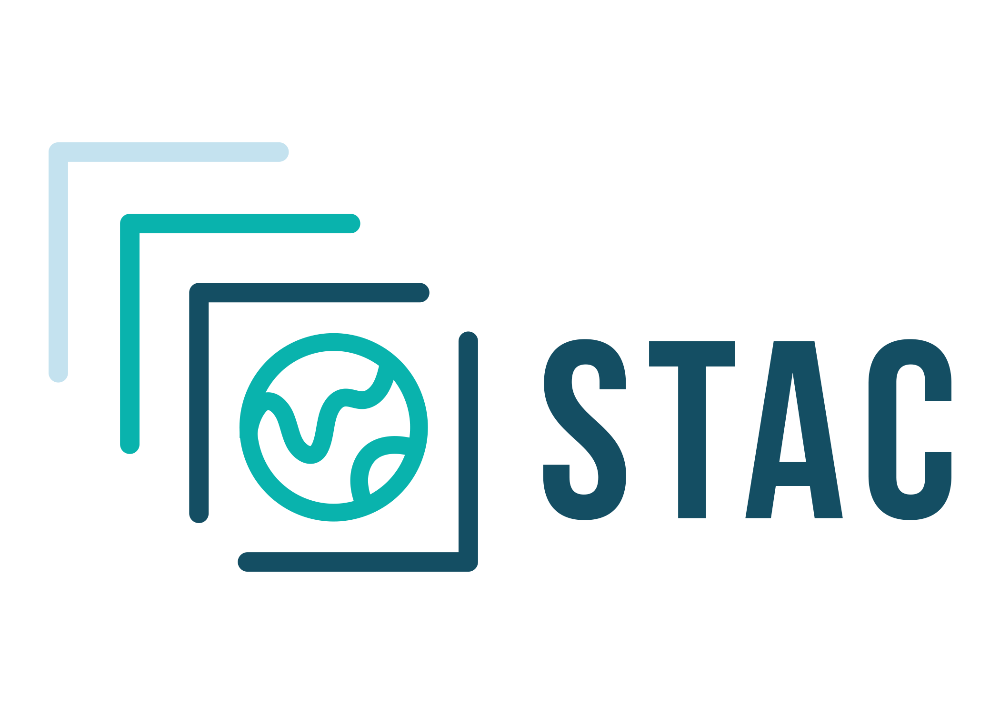
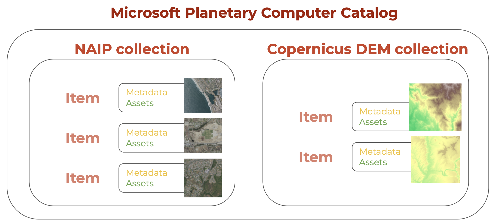
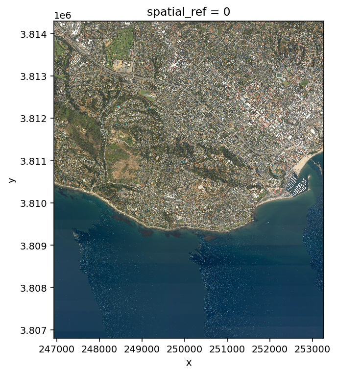

# 18 STAC specification

So far in our course we have obtained data in two ways: by downloading it directly from the data provider or by obtaining a URL from a data repository. 
These can be convenient ways to access targeted datasets, often using graphical user interfaces (GUIs) for data discovery and filtering.
However, relying on clicking and copy-pasting addresses and file names can make our workflows more error-prone and less reproducible. 
In particular, satellites around the world produce terabytes of new data daily and manually browsing through data repositories can make it difficult to access this data. 
Moreover, it can be inconvenient to learn a new way to access data from every single big data provider.
This is where STAC comes in.

{width="60%" fig-align="center"}

The **SpatioTemporal Asset Catalog (STAC)** is an open standard for geospatial data that aims to increase the interoperability of geospatial data, particularly satellite imagery. 
[Many major data archives](https://stacspec.org/en/about/datasets/) now follow the STAC specification.

In the next classes we'll be working with the [Microsoft Planetary Computer (MPC)](https://planetarycomputer.microsoft.com) STAC API. 
In this lesson we will learn about the main components of a STAC catalog and how to search for data using the MPC's STAC API. 

## Item, collection, and catalog
The **STAC item** (or just item) is the building block of a STAC. 
An item is a GeoJSON feature with additional fields that make it easier to find it as we look for data across catalogs. 

An item holds two types of information:

1. **Metadata:** The metadata for a STAC item includes core identifying information (such as ID, geometry, bounding box, and date), and additional properties (for example, place of collection). 

2. **Assets:** Assets are links to the actual data of the item (for example, links to the spectral bands of a satellite image).

STAC items can be grouped into **STAC collections**. 
For example, while a single satellite scene (at a single time and location) would constitute an item, scenes across time and location from the same satellite can be organized in a collection. 
Finally, multiple collections can be organized into a single **STAC catalog**. 

For example, we'll be accessing the MPC STAC catalog. Two of its collections are the National Agriculture Imagery Program (NAIP) collection and the Copernicus Digital Elevation Model (DEM) collection. Each of these collections has multiple items, with each item containing metadata and assets (links to the data). 



## Application Programming Interface (API)
To request data from a catalog following the STAC standard we use an **Application Programming Interface (API)**. 
We can think of an API as an intermediary tasked with sending our request for data to the data catalog and getting the response from the catalog back to us. 
The following diagram nicely explains what an API does using a real-life analogy of a restaurant:

](/book/images/lesson-16/what-is-an-api.png)

The Python package to access APIs for STAC catalogs is [`pystac_client`](https://pystac-client.readthedocs.io/en/stable/). 
Our goal in this lesson is to retrieve [NAIP data](https://naip-usdaonline.hub.arcgis.com) from the [MPC's data catalog](https://planetarycomputer.microsoft.com/catalog) via its STAC API @usda_naip_mpc.

## MPC catalog
<!--https://github.com/NCEAS/msai4earth-esa/blob/main/examples/naip_example/access_naip.ipynb-->
First, load the necessary packages:

```{python}
import rioxarray as rioxr
import geopandas as gpd
import matplotlib.pyplot as plt

from shapely.geometry import shape  # To turn GeoJSON dictionaries into geometries

from pystac_client import Client  # To access STAC catalogs
import planetary_computer  # To sign items from the MPC STAC catalog 

from IPython.display import Image  # To nicely display images
```

### Access
We use the `open()` method of the `Client` class from the `pystac_client` package to access the catalog:
```{python}
# Access MPC catalog
catalog = Client.open(
    "https://planetarycomputer.microsoft.com/api/stac/v1",
    modifier=planetary_computer.sign_inplace,
)
```

The `modifier` parameter is needed to access the data in the MPC catalog.

### Catalog exploration
Let's check out some of the catalog's metadata:
```{python}
# Explore catalog metadata
print('Title:', catalog.title)
print('Description:', catalog.description)
```

We can access its collections by using the `get_collections()` method:

```{python}
catalog.get_collections()
```

Notice the output of `get_collections()` is a **generator**. 
This is a special kind of **lazy object** in Python that you can loop over like a list. 
Unlike a list, the items in a generator do not exist in memory until you explicitly iterate over them or convert them to a list. This can allow for more efficient memory allocation. Once the generator is exhausted (i.e. iterated over completely), it cannot be reused unless it is recreated.

Let's try getting the collections from the catalog again:

```{python}
# Get collections and print their names
collections = list(catalog.get_collections())  # Turn generator into list

print('Number of collections:', len(collections))

print("Collection IDs (first 10):")
for i in range(10):
    print('-', collections[i].id)
```

## Collection
The NAIP collection's ID is `'naip'`. 
We can select a single collection for exploration using the `get_collection()` method for the catalog and the collection ID as the parameter:
```{python}
naip_collection = catalog.get_collection('naip')
naip_collection
```

<!--
https://pystac.readthedocs.io/en/latest/api/pystac.html#pystac.Collection

https://pystac.readthedocs.io/en/stable/api/item_collection.html#pystac-item-collection
-->

## Catalog search
We can narrow down the search within the `catalog` by specifying a time range, an area of interest, and the collection name. 
The simplest ways to define the area of interest to look for data in the catalog are:

- a GeoJSON-type dictionary with the coordinates of the bounding box,
- a list `[xmin, ymin, xmax, ymax]` with the coordinate values defining the four corners of the bounding box.

In this lesson we will look for all the NAIP scenes over Santa Barbara available up to November 16, 2026. 
The `..` at the start of the time range leaves the start date open, so the search returns every scene up to the end date.
We'll use the GeoJSON method to define the area of interest:

```{python}
# Temporal range of interest
time_range = "../2026-11-16"

# NCEAS bounding box (as a GeoJSON, CRS=EPSG:4326)
aoi = {
    "type": "Polygon",
    "coordinates":[
        [
            [-119.70608227128903, 34.426300194372274],
            [-119.70608227128903, 34.42041139020533],
            [-119.6967885126002, 34.42041139020533],
            [-119.6967885126002, 34.426300194372274],
            [-119.70608227128903, 34.426300194372274]
        ]
    ],
}

# Catalog search
search = catalog.search(
    collections = ['naip'],
    intersects = aoi,
    datetime = time_range)
search
```

To get the items found in the search (or check if there were any matches in the search) we use the `item_collection()` method:

```{python}
# Retrieve search items
items = search.item_collection()
len(items)
```

This output tells us there were seven items in the catalog that matched our search!

```{python}
items
```

## Item
<!--https://pystac.readthedocs.io/en/stable/api/pystac.html#pystac.Item-->
:::{.callout-tip}
## Check-in
Our search returned several items. Run the code below to see what distinguishes them.

```python
for scene in items:
    print(scene.id, scene.properties['datetime'], scene.properties['gsd'])
```

Here `gsd` stands for [ground sample distance at the sensor](https://github.com/radiantearth/stac-spec/blob/master/commons/common-metadata.md#instrument), in meters (m). This is the pixel size of the raster. 

1. What differs between the items besides the year?
2. Suppose you want to compare the vegetation around NCEAS with the 2018 image from the [`rioxarray` lesson](lesson-15-rioxarray/lesson-15-rioxarray.qmd). Which item would you pick, and why? 
:::


<!--
Answer: gsd (pixel size, in meters) is 1.0 m in 2012 and 2014 and 0.6 m from 2016 on.
The flight month also varies between May and July.
Defensible picks: 2020 or 2022 (same 0.6 m pixels, similar season to the July 2018 flight)
or 2024 (most recent, same pixel size). Weak pick: 2012 or 2014 (coarser pixels).
Key point: items[0] is just the order the API returns, not a choice anyone made.
-->

In our search the items are listed from newest to oldest, so `items[0]` is the most recent scene.
We'll work with this one for the rest of the lesson:

```{python}
# Get first (most recent) item in the catalog search
item = items[0]
type(item)
```

Remember the [STAC item](https://pystac.readthedocs.io/en/stable/api/pystac.html#pystac.Item) is the core object in a STAC catalog. 
The item does not contain the data itself, but rather metadata and assets. The assets contain links to access the actual data.
Some of the metadata:

```{python}
# Print item ID and properties
print('ID:' , item.id)
item.properties
```

:::{.callout-tip}
## Check-in
From the item's properties, when was this image taken, at what resolution, and in what CRS?
Is the time of day in `datetime` believable?
:::

<!--
Answer (2024 item): datetime 2024-06-25, gsd 0.6 m, CRS EPSG:26911 (NAD83 / UTM zone 11N).
The time is a placeholder: all NAIP items show T00:00 or T16:00, so only the date is meaningful.
-->

### Footprint

The **footprint** of the item is the area on the ground its data covers. We can access it with the `geometry` attribute:

```{python}
item.geometry
```

Before loading the data we want to see how the item intersects with our `aoi` around NCEAS. To do this, we create a `gpd.GeoDataFrame` for each of the geometries. The new piece is the `shape()` function from the `shapely` package, which turns a GeoJSON-type dictionary into a geometry. Both our `aoi` and the item's geometry are GeoJSON-type dictionaries, and STAC geometries always use longitude and latitude coordinates (EPSG:4326).

```{python}
# Turn the AOI and the item's footprint into geodataframes
aoi_gdf = gpd.GeoDataFrame(geometry=[shape(aoi)], crs='EPSG:4326')
footprint = gpd.GeoDataFrame(geometry=[shape(item.geometry)], crs='EPSG:4326')
```

The code below plots the item's footprint together with our area of interest.
<!-- Read it before running it: most of it uses tools you already know from `geopandas`. -->


```{python}
# Plot the footprint outline and the AOI on the same axis
fig, ax = plt.subplots()
footprint.plot(ax=ax, color='none', edgecolor='black')
aoi_gdf.plot(ax=ax, color='red')
ax.set_title('NAIP item footprint (black) and our area of interest (red)')
plt.show()
```

Our area of interest is a small part of the item.
When we search with `intersects`, the catalog returns every *whole* item that touches our area of interest.
It doesn't clip the data to it.

<!--
Answer: the footprint is about 6.5 km × 7.7 km, around 85 times the area of the AOI.
Extra: the footprint looks slightly tilted because the image is a rectangle in its own CRS
(UTM zone 11N), not in longitude and latitude.
-->

### Assets

Just as the item properties, the item assets are given in a dictionary, with each value being a [`pystac.Asset`](https://pystac.readthedocs.io/en/stable/api/asset.html).
Let's check the assets in the `item`:

```{python}
item.assets
```
```{python}
for key in item.assets.keys():
    print(key, '--', item.assets[key].title)
```


Notice each asset has an `href`, which is a link to the data. 
For example, we can use the URL for the `'thumbnail'` asset to plot a small preview of the scene:

```{python}
# Plot thumbnail preview
Image(url=item.assets['thumbnail'].href, width=300)
```

## Load data
The raster data in our current `item` is in the `image` asset. 
Again, we access this data via its URL. 
This time, we open it using `rioxr.open_rasterio()` directly:

```{python}
sb = rioxr.open_rasterio(item.assets['image'].href)
sb
```

Notice the output doesn't show any data values, only `[526656000 values with dtype=uint8]`.
That's because `open_rasterio()` only read the file's metadata: its dimensions, coordinates and CRS.
The data itself (about 500 MB) stays in the cloud until we use it, for example to plot it or to compute a statistic.
This is the same lazy behavior we saw with generators.
The NAIP files are stored as **Cloud-Optimized GeoTIFFs (COGs)**, a format designed so we can read just the part of a file we need instead of downloading all of it.

Notice this raster has four bands (red, green, blue, nir), so we cannot plot it directly: `.plot.imshow()` would read the fourth band (NIR) as transparency. 
Thus we need to select the bands we want to plot (RGB) before plotting:

```{python}
#| eval: false
# Plot raster with correct ratio
size = 6  
aspect = sb.rio.width / sb.rio.height 
# Select R,G,B bands and plot
sb.sel(band=[1,2,3]).plot.imshow(size=size, aspect=aspect)
```

{width="70%"}

:::{.callout-tip}

**TO DO: fix DEM exercise**

## Exercise
The [Copernicus Digital Elevation Model (DEM)](https://planetarycomputer.microsoft.com/dataset/group/copernicus-dem) collection contains elevation data at 90 m spatial resolution @esa_copernicus_dem_glo90. The collection ID in the MPC catalog is `'cop-dem-glo-90'`.

1) Reuse the `aoi` for Santa Barbara to look for items in this collection. 
2) Get the first item in the search and examine its properties and assets.
3) Check the item's rendered preview asset by clicking on its URL.
4) Open and plot the item's data using `rioxarray`, save it into a variable named `dem`.
5) Obtain the maximum and minimum elevation on the scene as *numbers*. 
6) Print the maximum and minimum elevation [rounded to two decimal places using f-strings](https://stackoverflow.com/questions/46062105/rounding-floats-with-f-string). For vertical units, consult the [data's handbook](https://object.cloud.sdsc.edu/v1/AUTH_opentopography/www/metadata/Copernicus_metadata.pdf).
:::

<!--

```{python}
# Open DEM item over SB
search = catalog.search(
    collections=["cop-dem-glo-90"],
    intersects = aoi,
)
items = search.item_collection()

dem = rioxr.open_rasterio(items[0].assets['data'].href)
```
-->

<!--
## Exercise
Recreate the following image, where the red rectangle shows the bounding box used to do the catalog search. 
HINT: `aoi` as it is now is a dictionary. How can you get the vertices list out of it to first create a `shapely` `Polygon`?


```{python}
#| eval: false
#| 
aoi = gpd.GeoDataFrame(geometry=[Polygon(aoi['coordinates'][0])],
                crs='epsg:4326')
aoi.plot()
```

```{python}
#| eval: false
#| 
# reproject aoi to rgb crs
aoi = aoi.to_crs(sb.rio.crs)
print('matched crs?',  aoi.crs == sb.rio.crs)
aoi.crs
```

```{python}
#| eval: false
#| 
fig, ax = plt.subplots()

size = 6 # plot height in inches
aspect = sb.rio.width / sb.rio.height # ratio of width/height
fig.set_size_inches((size, size*aspect)) # reuse size and aspect

sb.sel(band=[1,2,3]).plot.imshow(ax=ax)
aoi.plot(ax=ax, color='red', alpha=0.6)
```
-->


## Further reading
STAC Documentation:

- [The STAC Specification](https://stacspec.org/en/tutorials/intro-to-stac/)

- [Read a STAC Catalog Using PySTAC](https://stacspec.org/en/tutorials/1-read-stac-python/)

- [Microsoft Planetary Computer Documentation - Reading Data from the STAC API](https://planetarycomputer.microsoft.com/docs/quickstarts/reading-stac/)

<!-- https://planetarycomputer.microsoft.com/docs/tutorials/hurricane-florence-animation/

Idea for homework:

https://planetarycomputer.microsoft.com/dataset/io-biodiversity#Example-Notebook

-->

<!--

```{python}
#| eval: false
from shapely import Polygon
import matplotlib.pyplot as plt
import geopandas as gpd
```
An easy way to obtain coordinates for such a region:

1. go to  [https://geojson.io/](https://geojson.io/) website,
2. zoom in until you find the NCEAS building in Santa Barbara, it might help to change to 'Satellite Streets' view on the bottom left corner, 
3. click on the rectangle icon on the right-side toolbar and draw a small region around the NCEAS building,
4. the geoJSON code representing this area will appear in the code box,
5. one option is to copy-paste this geoJSON into an empty text file and save such file with the .json extension, we could then read it in using `geopandas`
6. instead, we will create our region of interest by just *copy-pasting the list of points* and storing it as a variable:

```{python}
#| eval: false
#| 
# vertices of our aoi box
points = [[-119.70608227128903, 34.426300194372274],
          [-119.70608227128903, 34.42041139020533],
          [-119.6967885126002, 34.42041139020533],
          [-119.6967885126002, 34.426300194372274],
          [-119.70608227128903, 34.426300194372274]]
```

We can then create a new `geopandas.GeoDataFrame`:

```{python}
#| eval: false
#| 
# create geodataframe with aoi 
aoi = gpd.GeoDataFrame(geometry=[Polygon(points)],
                           crs='epsg:4326')
aoi
```

Let's break this down a bit:

- first, we use the `shapely`'s `Polygon()` function to create a polygon from our `points` list. 
- in `[Polygon(points)]` we put this polygon inside a list so we can form the geometry column of our new `gpd.GeoDataFrame`
- we know all the geoJSON files have CRS equal to EPSG:4326/WGS 84, so we set the CRS of our new `gpd.GeoDataFrame` to this.
-->