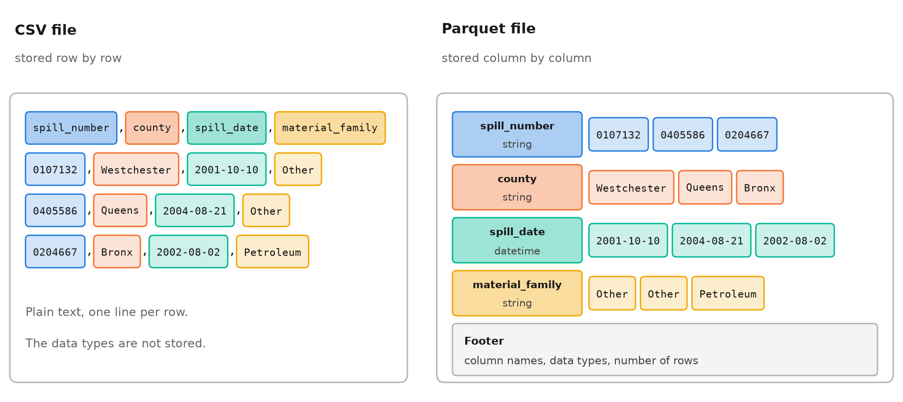
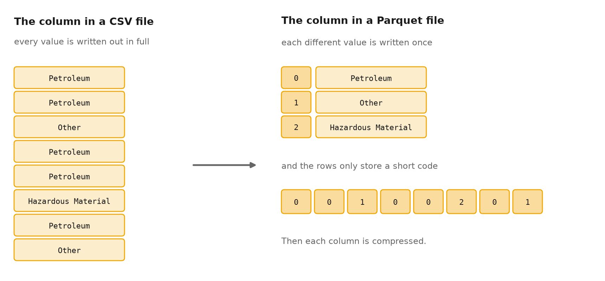
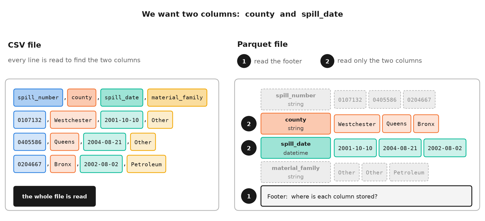
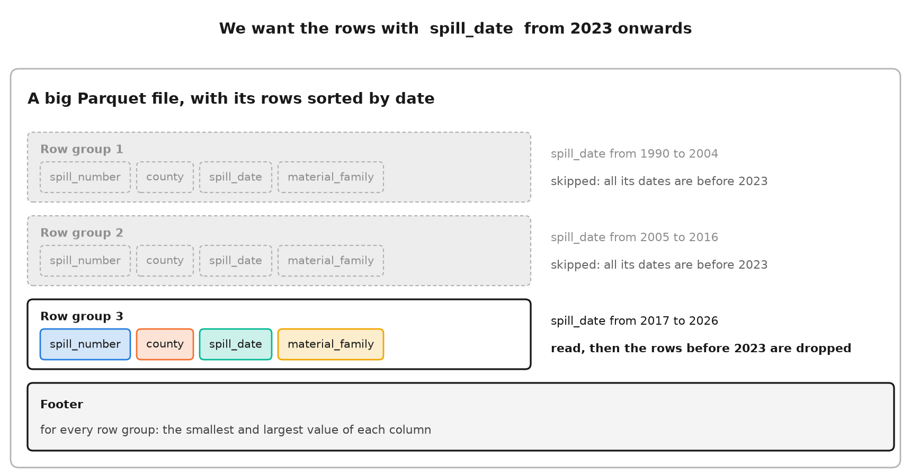
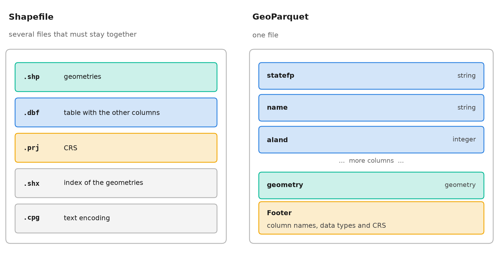
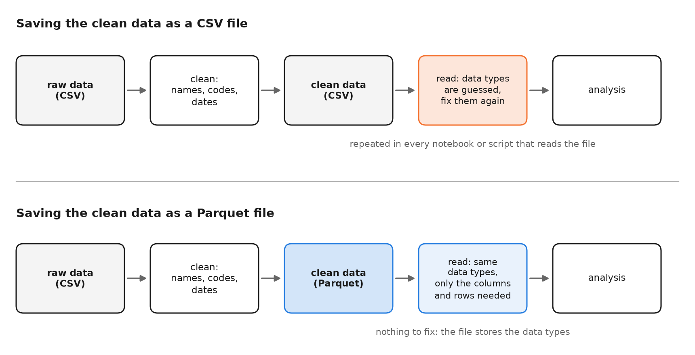
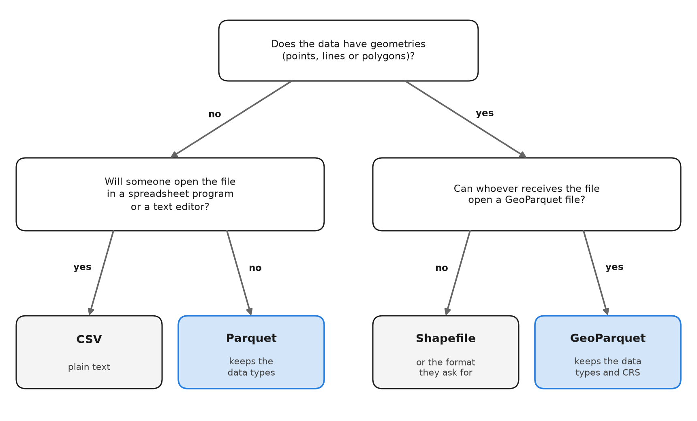

In assignment 3 we worked with a CSV file with more than half a million rows about spill incidents in New York State. Every time we restarted the notebook we had to read the whole 100 MB file again and repeat the same cleaning steps: simplify the column names and convert the dates. Is there a way to save our cleaned data so that it comes back exactly as we left it? And can we open only the part of a big file that we need? In this lesson we answer these questions with **Parquet**, a file format designed for data analysis, and **GeoParquet**, its geospatial version.

By the end of this lesson, students will be able to:

- explain the difference between a row-based file format and a column-based file format,
- save a `pandas.DataFrame` as a Parquet file and read it back,
- compare a CSV file and a Parquet file by the data types they keep, their size and the time they take to read,
- read only the columns and rows they need from a Parquet file,
- save a `geopandas.GeoDataFrame` as a GeoParquet file and compare it with a shapefile, and
- decide which file format to use at each step of a workflow.

## About the data

In this lesson we will use the two datasets from [assignment 3](/assignments/assignment3.qmd).

The first one is the [Spill Incidents dataset](https://data.ny.gov/Energy-Environment/Spill-Incidents/u44d-k5fk) from the New York State Department of Environmental Conservation @nysdec_spill_incidents_2026. It is a CSV file with information about spills of petroleum and other hazardous materials: where and when each spill happened, the material and the quantity spilled.

The second one is the [TIGER shapefile of the US counties from the United States Census Bureau](https://www.census.gov/geographies/mapping-files/time-series/geo/tiger-line-file.2026.html) @us_census_bureau_tiger_2026_counties.

:::{.callout-tip appearance="minimal"}
Copy the following from the `data` directory of your `eds220-hwk3` repository into a `data` directory next to your notebook:

- the spills CSV file (`Spill_Incidents_YYYYMMDD.csv`), and
- the `tl_2026_us_county` folder.

The date at the end of the name of your spills file may be different from the one in these notes, depending on when you downloaded it.
:::

`pandas` and `geopandas` use the [`pyarrow`](https://arrow.apache.org/docs/python/) package to read and write Parquet files @apache_arrow.

:::{.callout-tip appearance="minimal"}
To check whether `pyarrow` is installed in your `eds220-env` environment, run `import pyarrow` in a notebook cell. If you get an error, open a terminal and run:

```bash
conda activate eds220-env
conda install -c conda-forge pyarrow
```

Then restart the kernel of your notebook.
:::

## Row-based and column-based formats

A CSV file is a **row-based** format. It is a plain text file where each line is one row of the table and the values in the row are separated by commas. These are three rows from our spills file, showing only four of its columns:

```default
Spill Number,County,Spill Date,Material Family
0107132,Westchester,10/10/2001,Other
0405586,Queens,08/21/2004,Other
0204667,Bronx,08/02/2002,Petroleum
```

Everything in a CSV file is text. The file doesn't say whether `0107132` is a number or a code, or whether `10/10/2001` is a date. `pandas` has to guess each column's data type every time it reads the file.

[**Apache Parquet**](https://parquet.apache.org/) is an open source, **column-based** (or *columnar*) format @apache_parquet. It stores the values of each column together, along with the column's name and data type. At the end of the file there is a **footer** that describes its contents. The figure below shows three rows of the spills table stored in the two formats, with one color per column. The table in the figure is the clean version we will create in a moment, with simplified column names and the dates stored as dates:

{fig-alt="Three rows of the clean spills table stored as a CSV file and as a Parquet file. In the CSV file each line is a row and the values of the four columns alternate. In the Parquet file the values of each column are stored together with the column's name and data type, followed by a footer with the column names, data types and number of rows."}

Parquet files have three properties that we will see in this lesson:

1. **The data types are saved in the file.** A date is read back as a date and a code as a code.
2. **The files are smaller.** The values within a column are similar to each other, so they can be compressed well.
3. **We can read part of the file.** Each column is stored separately, so to read three columns out of twenty only those three columns are read.

The main differences between the two formats are:

| | CSV | Parquet |
|---|---|---|
| Layout | row by row | column by column |
| Stored as | plain text | compressed binary |
| Data types | guessed when reading the file | saved in the file |
| Reading a few columns | the whole file is read | only those columns are read |
| Can be opened in a text editor | yes | no |

Parquet is not specific to Python. For example, the `arrow` package reads and writes Parquet files in R.

## Import and clean the CSV

Let's start by importing the packages we will use:

```{python}
import os
import time

import pandas as pd
import geopandas as gpd
import matplotlib.pyplot as plt
import pyarrow.parquet as pq
```

Next, we import the spills data and repeat the cleaning from assignment 3: we simplify the column names and convert the three columns with dates from strings to dates.

We also want to know how long it takes to read the file, so we will time it with the `time()` function from the `time` module. `time.time()` returns the current time in seconds. Calling it before and after reading the file and subtracting gives us the seconds it took:

```{python}
# Update the file name to match your file
fp_csv = os.path.join('data', 'Spill_Incidents_20261030.csv')

# Read the CSV file and time it
start = time.time()
spills = pd.read_csv(fp_csv, dtype={'Spill Number': str, 'SWIS Code': str})
csv_seconds = time.time() - start

# Simplify column names
spills.columns = spills.columns.str.lower().str.replace(' ', '_')

# Convert the date columns from strings to dates
for column in ['spill_date', 'received_date', 'close_date']:
    spills[column] = pd.to_datetime(spills[column])

print(f"Time to read the CSV file: {csv_seconds:.2f} seconds")
```

Notice the `dtype` parameter. The spill numbers and the SWIS codes are codes that can start with zeros, like `0107132` and `0301`. With `dtype` we tell `pandas` to read these two columns as strings so the zeros are kept.

These are the data types of our clean data frame:

```{python}
spills.dtypes
```

## Saving to CSV loses information

Our data is clean now. Suppose we want to save it so we don't have to repeat the cleaning the next time we open the notebook. The `to_csv()` method saves a data frame as a CSV file. With `index=False` the index is not written to the file:

```{python}
# Save the clean data as a CSV file
fp_clean_csv = os.path.join('data', 'spills_clean.csv')
spills.to_csv(fp_clean_csv, index=False)

# Read it again
spills_from_csv = pd.read_csv(fp_clean_csv)
```

Let's compare the data types of the data frame we saved and the one we read back:

```{python}
pd.DataFrame({'clean': spills.dtypes,
              'from_csv': spills_from_csv.dtypes})
```

:::{.callout-tip}
## Check-in
1. Which columns changed data type?
2. Compare the output of `spills['spill_number'].head(3)` and `spills_from_csv['spill_number'].head(3)`. What happened to the spill numbers?
3. Did we get a warning or an error at any point?
:::

```{python}
#| include: false
# Check-in answer:
# 1. spill_date, received_date and close_date went from dates back to strings,
#    and spill_number and swis_code went from strings to integers.
# 2. The leading zeros are gone: '0107132' became 107132.
# 3. No. Reading the CSV again undid part of our cleaning without any message.
print(spills['spill_number'].head(3))
print(spills_from_csv['spill_number'].head(3))
```

The CSV file kept the values as text and lost the data types. When we read it again `pandas` guessed the types, and its guesses were not the ones we had set. We would need to remember to use `dtype` and to convert the dates every time we read the file.

:::{.callout-warning}
## A silent failure
The spill numbers and the SWIS codes lost their leading zeros and we did not get any warning. This is another example of a [silent failure](/book/chapters/lesson-15-rioxarray/lesson-15-rioxarray.qmd#data-type-issues). After saving data and reading it back, check that you got what you saved.
:::

## Write and read a Parquet file

Now let's save the same data frame as a Parquet file using the [`to_parquet()` method](https://pandas.pydata.org/docs/reference/api/pandas.DataFrame.to_parquet.html):

```{python}
# Save the clean data as a Parquet file
fp_parquet = os.path.join('data', 'spills.parquet')
spills.to_parquet(fp_parquet)
```

To read it back we use the [`pd.read_parquet()` function](https://pandas.pydata.org/docs/reference/api/pandas.read_parquet.html). We time it too:

```{python}
start = time.time()
spills_from_parquet = pd.read_parquet(fp_parquet)
parquet_seconds = time.time() - start

print(f"Time to read the CSV file: {csv_seconds:.2f} seconds")
print(f"Time to read the Parquet file: {parquet_seconds:.2f} seconds")
```

The times change from one computer to another and from one run to the next, and the first time we read a Parquet file in a session can be slower. Run the cell that reads the Parquet file a couple of times before drawing a conclusion.

:::{.callout-tip}
## Check-in
Which file was faster to read on your computer? How many times faster?
:::

### Data types

Let's compare the data types again, now with the three data frames:

```{python}
pd.DataFrame({'clean': spills.dtypes,
              'from_csv': spills_from_csv.dtypes,
              'from_parquet': spills_from_parquet.dtypes})
```

The data frame we read from the Parquet file has the same data types as the one we saved. The dates are dates and the codes are strings. In fact, the two data frames are equal:

```{python}
# Check the data we read is the same as the data we saved
spills_from_parquet.equals(spills)
```

### File size

The `os.path.getsize()` function returns the size of a file in bytes. Let's use it to compare the two files we saved, which contain the same data:

```{python}
# File sizes in megabytes (1 MB = 1000^2 bytes)
csv_size = os.path.getsize(fp_clean_csv) / 1000**2
parquet_size = os.path.getsize(fp_parquet) / 1000**2

print(f"CSV file: {csv_size:.1f} MB")
print(f"Parquet file: {parquet_size:.1f} MB")
print(f"The CSV file is {csv_size / parquet_size:.1f} times bigger than the Parquet file")
```

The Parquet file is several times smaller than the CSV file. One reason is that the values in a column repeat a lot. For example, the `material_family` column has more than half a million rows and only four different values:

```{python}
spills['material_family'].value_counts()
```

A CSV file writes out `Petroleum` in full in every row where it appears. A Parquet file writes each different value of the column once and, for each row, it only stores a short code that points to the value. After that, each column is compressed. The figure below shows this for eight example rows that have three of the four values:

{width="85%" fig-align="center" fig-alt="A column with the values Petroleum, Other and Hazardous Material repeated over eight rows. In a CSV file every value is written out in full. In a Parquet file each different value is written once next to a code (0, 1, 2) and the eight rows only store the codes. Then each column is compressed."}

:::{.callout-tip}
## Check-in
A Parquet file is not a text file, so we can't read it in a text editor the way we read a CSV file. When could this be a disadvantage?
:::

```{python}
#| include: false
# Check-in answer:
# We can't look at a Parquet file, or edit it, without code or a dedicated tool.
# This matters when the data is small and we want to inspect it quickly,
# or when we share it with someone who doesn't code.
```

## Read only what you need

So far we have read the whole Parquet file. Its main advantage shows up when we only need a part of it.

### Look at the file before loading it

A Parquet file stores a description of its contents, called its **metadata**. The metadata includes the number of rows and the file's **schema**: the name and data type of each column. We can read the metadata without loading any data, using the `pyarrow.parquet` module we imported as `pq`:

```{python}
# Number of rows and columns
metadata = pq.read_metadata(fp_parquet)
print(f"Rows: {metadata.num_rows}")
print(f"Columns: {metadata.num_columns}")
```

```{python}
# Names and data types of the columns
pq.read_schema(fp_parquet)
```

The line after `-- schema metadata --` is extra information `pandas` saved to rebuild the data frame.

This is the same idea we saw in the [STAC lesson](/book/chapters/lesson-16-STAC.qmd#load-data), where `rioxr.open_rasterio()` read the raster's dimensions and CRS without loading its values. For a file with many gigabytes of data, checking the schema first tells us which columns we need before reading any of them.

### Select columns

Suppose we only need two columns of the table. To get them from a CSV file, every line of the file has to be read. With a Parquet file, the footer is read first (step 1 in the figure), since it says where each column is stored in the file. Then only the two columns we asked for are read (step 2), and the rest of the file is skipped:

{fig-alt="Reading the county and spill_date columns from a CSV file and from a Parquet file. In the CSV file the whole file is read. In the Parquet file the footer is read first, then only the county and spill_date columns. The spill_number and material_family columns are skipped."}

The `columns` parameter of `pd.read_parquet()` takes a list with the names of the columns to read:

```{python}
start = time.time()
spills_subset = pd.read_parquet(fp_parquet, columns=['county', 'spill_date'])
subset_seconds = time.time() - start

print(f"Time to read 2 of the {metadata.num_columns} columns: {subset_seconds:.2f} seconds")
spills_subset.head(3)
```

### Select rows

The `filters` parameter selects rows while reading the file. Each condition is a tuple with three elements, `(column, operator, value)`, and the conditions go in a list. A row is read only if it satisfies all the conditions.

In assignment 3 we selected the petroleum spills that happened in 2023. This is how we get the same rows directly from the file:

```{python}
# Conditions: petroleum spills between January 1 and December 31, 2023
conditions = [('material_family', '==', 'Petroleum'),
              ('spill_date', '>=', pd.Timestamp('2023-01-01')),
              ('spill_date', '<=', pd.Timestamp('2023-12-31'))]

petr_23 = pd.read_parquet(fp_parquet, filters=conditions)

print(f"Rows in file: {metadata.num_rows}")
print(f"Rows read: {len(petr_23)}")
```

:::{.callout-caution}
## The value must have the same data type as the column
`spill_date` is a column with dates, so we compare it with a date: `pd.Timestamp('2023-01-01')`. Comparing it with the string `'2023-01-01'` raises an error. This is different from selecting rows in a data frame, where `pandas` converts the string to a date for us.
:::

:::{.callout-tip}
## Check-in
Verify the result. Use the `spills` data frame to select the petroleum spills from 2023 the way you did in assignment 3, and check that you get the same number of rows as in `petr_23`.
:::

```{python}
#| include: false
# Check-in answer
petr_23_check = spills[(spills['material_family'] == 'Petroleum') &
                       (spills['spill_date'].between('2023-01-01', '2023-12-31'))]

assert len(petr_23) == len(petr_23_check)
print(f"Rows selecting from the data frame: {len(petr_23_check)}")
```

How can rows be skipped inside a file? A big Parquet file is divided into **row groups**, each with part of the rows, and the footer stores the smallest and the largest value of each column in each row group. With this information, the row groups that can't have any of the rows we asked for are not read. This saves the most when the rows in the file are sorted by the column in the condition, as in the figure below:

{fig-alt="A big Parquet file with its rows sorted by date. It has three row groups and a footer that stores the smallest and largest value of each column for every row group. To get the rows with spill_date from 2023 onwards, the two row groups whose dates end before 2023 are skipped. Only the third row group is read, and then its rows before 2023 are dropped."}

Our spills file is small and has a single row group, which you can check with `metadata.num_row_groups`. So in our case no rows are skipped inside the file: the columns are read and then the rows that satisfy the conditions are kept. Skipping row groups makes a difference with bigger files.

We can use `columns` and `filters` together. The columns in the conditions don't need to be among the columns we read:

```{python}
# County and date of spills in the oxygenates material family
oxygenates = pd.read_parquet(fp_parquet,
                             columns=['county', 'spill_date'],
                             filters=[('material_family', '==', 'Oxygenates')])
oxygenates.head(3)
```

With our file the whole table fits in memory, so selecting while reading is a convenience. With a dataset that is bigger than our computer's memory, or one stored in the cloud, reading only the columns and rows we need is what makes it possible to work with the data at all.

## GeoParquet

[**GeoParquet**](https://geoparquet.org/) is an open specification for storing vector data in Parquet files, which is being developed as an Open Geospatial Consortium (OGC) standard @geoparquet. A GeoParquet file is a Parquet file where one of the columns holds the geometries and the file's metadata includes the CRS. Everything we have seen about Parquet files still applies.

In the [lesson about vector data formats](/book/chapters/lesson-9-vector-data.qmd) we saw that a shapefile is a collection of several files. The figure below shows where the geometries, the other columns and the CRS are stored in each format. Matching colors mark the same information:

{fig-alt="A shapefile is several files: .shp with the geometries, .dbf with the table of the other columns, .prj with the CRS, .shx with an index of the geometries and .cpg with the text encoding. A GeoParquet file is one file with the columns statefp, name, aland and more, a geometry column, and a footer with the column names, data types and CRS."}

Let's import the counties shapefile from assignment 3:

```{python}
# Import the US counties shapefile
fp_shp = os.path.join('data', 'tl_2026_us_county', 'tl_2026_us_county.shp')
counties = gpd.read_file(fp_shp)

# Simplify column names
counties.columns = counties.columns.str.lower()

print(f"CRS: {counties.crs}")
counties.head(3)
```

### Write and read a GeoParquet file

A `geopandas.GeoDataFrame` also has a [`to_parquet()` method](https://geopandas.org/en/stable/docs/reference/api/geopandas.GeoDataFrame.to_parquet.html), which saves it as a GeoParquet file:

```{python}
# Save the counties as a GeoParquet file
fp_geoparquet = os.path.join('data', 'counties.parquet')
counties.to_parquet(fp_geoparquet)
```

To read the file we use the [`gpd.read_parquet()` function](https://geopandas.org/en/stable/docs/reference/api/geopandas.read_parquet.html):

```{python}
counties_from_parquet = gpd.read_parquet(fp_geoparquet)

print(f"Type: {type(counties_from_parquet)}")
print(f"Same CRS as the data we saved: {counties_from_parquet.crs == counties.crs}")
print(f"Same data as the data we saved: {counties_from_parquet.equals(counties)}")
```

We get back a geodataframe with the same data and the same CRS.

:::{.callout-caution}
## Use `gpd.read_parquet()` for GeoParquet files
`pd.read_parquet()` can also open a GeoParquet file, but it returns a `pandas.DataFrame` where the geometry column is not a column of geometries and the CRS is missing. To get a `geopandas.GeoDataFrame`, read the file with `gpd.read_parquet()`.
:::

### File size

Let's compare the size of the shapefile with the size of the GeoParquet file. A shapefile is a collection of several files, so to get its size we add up the sizes of all the files in its folder. The `os.listdir()` function returns a list with the names of the files in a folder:

```{python}
# Add the sizes of all the files in the shapefile's folder
shp_folder = os.path.join('data', 'tl_2026_us_county')

shp_size = 0
for file in os.listdir(shp_folder):
    shp_size = shp_size + os.path.getsize(os.path.join(shp_folder, file))

shp_size = shp_size / 1000**2
geoparquet_size = os.path.getsize(fp_geoparquet) / 1000**2

print(f"Shapefile: {shp_size:.1f} MB")
print(f"GeoParquet file: {geoparquet_size:.1f} MB")
```

This time the two sizes are almost the same! Nearly all the space in this dataset is taken by the coordinates of the county boundaries. These are numbers with many digits that don't repeat, so they are not compressed much.

How much smaller a Parquet file is depends on the data, so we should measure it instead of assuming it. For the counties, the reasons to choose GeoParquet are different ones, as we will see next.

### Select columns and rows

`gpd.read_parquet()` also accepts the `columns` and `filters` parameters. When we use `columns`, the geometry column must be in the list. Let's read only the name, land area and geometry of the counties in New York State, which has state code 36. The `statefp` column is stored as strings, so in the condition we compare it with the string `'36'`:

```{python}
# Read three columns of the NY counties
ny_counties = gpd.read_parquet(fp_geoparquet,
                               columns=['name', 'aland', 'geometry'],
                               filters=[('statefp', '==', '36')])

print(f"Counties in the file: {len(counties)}")
print(f"Counties read: {len(ny_counties)}")
ny_counties.head(3)
```

```{python}
ny_counties.plot()
```

### Column names

We also saw that a shapefile cuts column names to 10 characters. Let's see what this looks like. The `aland` column has the land area of each county in square meters. We add a column with the land area in square kilometers:

```{python}
ny_counties['land_area_km2'] = ny_counties['aland'] / 1000**2
ny_counties.columns
```

Then we save the geodataframe in the two formats. The [`to_file()` method](https://geopandas.org/en/stable/docs/reference/api/geopandas.GeoDataFrame.to_file.html) saves a geodataframe as a shapefile when the file name ends in `.shp`:

```{python}
# Save the NY counties as a shapefile
fp_ny_shp = os.path.join('data', 'ny_counties.shp')
ny_counties.to_file(fp_ny_shp)

# Save the NY counties as a GeoParquet file
fp_ny_geoparquet = os.path.join('data', 'ny_counties.parquet')
ny_counties.to_parquet(fp_ny_geoparquet)
```

Notice the warning about the column names that we got when saving the shapefile. Now let's read both files and look at their column names:

```{python}
ny_from_shp = gpd.read_file(fp_ny_shp)
ny_from_geoparquet = gpd.read_parquet(fp_ny_geoparquet)

print(f"Original: {list(ny_counties.columns)}")
print(f"From shapefile: {list(ny_from_shp.columns)}")
print(f"From GeoParquet: {list(ny_from_geoparquet.columns)}")
```

:::{.callout-tip}
## Check-in
1. Which column name changed, and in which file?
2. Look at your `data` folder. How many files were created for `ny_counties.shp`? How many for `ny_counties.parquet`?
:::

```{python}
#| include: false
# Check-in answer:
# 1. land_area_km2 became land_area_ in the shapefile. The GeoParquet file kept the full name.
# 2. The shapefile is several files with the same name and different extensions
#    (.shp, .shx, .dbf, .prj, .cpg). The GeoParquet is a single file.
ny_files = []
for file in os.listdir('data'):
    if file.startswith('ny_counties'):
        ny_files.append(file)
print(sorted(ny_files))
```

To summarize the differences between the two formats:

| | Shapefile | GeoParquet |
|---|---|---|
| Number of files | several (`.shp`, `.shx`, `.dbf`, `.prj`, ...) | one |
| Column names | cut to 10 characters | complete |
| CRS | in a separate `.prj` file | inside the file |

## Which format should I use?

In this lesson we saved our clean data in two ways. When we saved it as a CSV file, the data types had to be fixed again after reading the file. When we saved it as a Parquet file, the data came back as we left it, and we could read only the columns and rows we needed:

{fig-alt="Two workflows. Saving the clean data as a CSV file: raw data, clean, clean data as CSV, read with the data types guessed and fixed again, analysis. The reading and fixing step is repeated in every notebook or script that reads the file. Saving the clean data as a Parquet file: raw data, clean, clean data as Parquet, read with the same data types and only the columns and rows needed, analysis."}

This doesn't mean Parquet is always the best choice. The right file format depends on what the file is for and who will open it:

{width="85%" fig-align="center" fig-alt="Flowchart to choose a file format. If the data has no geometries: use CSV when someone will open the file in a spreadsheet program or a text editor, and Parquet otherwise. If the data has geometries: use GeoParquet when whoever receives the file can open a GeoParquet file, and otherwise a shapefile or the format they ask for."}

Parquet is also the format to use when a table is too big to read whole, since we can read it by parts.

Parquet and GeoParquet are also common formats for big datasets stored in the cloud. For example, [Overture Maps](https://overturemaps.org/) publishes its global datasets of buildings, roads and places as GeoParquet files @overture_maps.

Parquet files are data files. Just like CSV files and shapefiles, they go in the `data` directory of your repository and should not be committed.

## Exercises

:::{.callout-tip}
## Exercise 1

Answer the following questions reading only the columns and rows you need from `spills.parquet`.

1. How many rows correspond to spills in the `'Hazardous Material'` material family?

```{python}
#| include: false
hazardous = pd.read_parquet(fp_parquet,
                            columns=['material_family'],
                            filters=[('material_family', '==', 'Hazardous Material')])
print(f"Rows for hazardous materials: {len(hazardous)}")
```

2. Read the `county` and `received_date` columns for the spills received on or after January 1, 2026. Which three counties have the most rows?

```{python}
#| include: false
received_26 = pd.read_parquet(fp_parquet,
                              columns=['county', 'received_date'],
                              filters=[('received_date', '>=', pd.Timestamp('2026-01-01'))])
received_26['county'].value_counts().head(3)
```

3. Check your answer to question 1 using the `spills` data frame.

```{python}
#| include: false
assert len(hazardous) == len(spills[spills['material_family'] == 'Hazardous Material'])
```
:::

:::{.callout-tip}
## Exercise 2

Discuss with a partner. For each situation, which file format would you choose and why?

1. You cleaned a table with 200 rows of field observations and need to email it to a collaborator who works with Excel.
2. Your final project has one notebook that cleans a large table and a second notebook that makes the plots.
3. You need the names and locations of the buildings in one neighborhood, and the full dataset has many columns and covers the whole world.
4. A government agency asks you to submit your fire perimeters and their submission form only accepts shapefiles.
:::

```{python}
#| include: false
# Exercise 2, points to listen for:
# 1. CSV: small, and the collaborator can open it without code.
# 2. Parquet: the second notebook gets the data with the data types the first one set.
#    The Parquet file stays out of the repository, like any other data file.
# 3. GeoParquet: we can read only the columns and the rows we need instead of the whole dataset.
# 4. Shapefile: the format follows the requirements of whoever receives the data.
#    Check the column names after saving.
```

## Further reading

- [`pandas` documentation - Parquet](https://pandas.pydata.org/docs/user_guide/io.html#parquet)

- [`geopandas` documentation - Apache Parquet and Feather file formats](https://geopandas.org/en/stable/docs/user_guide/io.html#apache-parquet-and-feather-file-formats)

- [Apache Parquet documentation](https://parquet.apache.org/docs/)

- [GeoParquet](https://geoparquet.org/)
